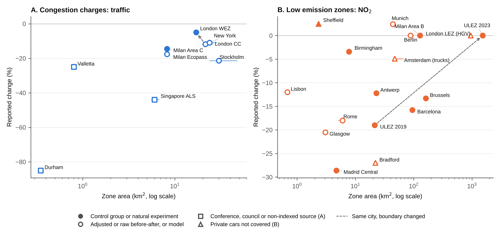

# S1. Inventory and search protocol

**Inventory.** The starting point was a hand-compiled database of 65 urban road charging and access regulation schemes (Congestion Charging Database, compiled by Rose [full name and acknowledgement to add]). Rows were kept if they defined a bounded area that vehicles are charged or restricted for entering or circulating in. Removed: 20 linear motorway, expressway or bridge tolls, two point-based gantry charges (Singapore ERP, Dubai Salik), three plans or packages without a zone restriction (Derby, Nottingham, Southampton), two licence-plate rationing schemes without a bounded zone (Mexico City Hoy No Circula, Bogotá Pico y Placa) and one duplicate (Utrecht). Added because peer-reviewed evaluations exist: Stockholm, Gothenburg, Singapore Area Licensing Scheme, Valletta, Durham, Oslo, Milan Ecopass, London Western Extension, Rome, London LEZ for heavy vehicles, Lisbon, Antwerp, Brussels. Result: 50 zone-based schemes. Errors corrected in the source database are listed in the README of the deposited workbook (for example, the Beijing zone description had been copied from Berlin).

**Scheme-by-scheme search (completed).** For each of the 50 schemes, searches were run in October and November 2026 in Google Scholar, Crossref and publisher sites combining the scheme name (and local name) with evaluation, traffic, air quality, NO2, PM10, difference-in-differences and synthetic control. Reference lists of Chamberlain et al. (2023), Holman et al. (2015) and Delgado-Lindeman et al. (2025) were screened. Working papers, preprints and agency reports were excluded as effect sources. Every DOI was resolved through Crossref. Values first taken from secondary summaries were checked against the full texts for Milan Area C (Gibson & Carnovale, 2015, Beria, 2016), Antwerp and Brussels (Bruyneel et al., 2025) and the London Western Extension (Ding et al., 2022). Values for Barcelona (abstract and an institutional summary), Tassinari (2024), Danielis et al. (2012) and Givoni (2012) were taken from abstracts, working-paper or conference versions and are flagged in the extraction files.

**Database search (to be run after protocol registration).** See S2.

**Extraction.** One row per scheme, outcome and measurement time. Fields: outcome metric, percentage change (negative = reduction), measurement location, years in operation at the midpoint of the evaluation window, design, spillover, citation and DOI. Where only an absolute change was reported, the percentage was computed against the baseline mean stated in the paper and flagged. Full extraction: 115 rows from 61 sources (deposited files cc_effects.csv and lez_effects.csv).

# S2. Search strategy, selection and charting protocol

### Eligibility (Population, Concept, Context)

| Element | Include | Exclude |
|---|---|---|
| Population | Not applicable (the units are schemes, not people); any urban population | |
| Concept (intervention) | Urban schemes with a bounded zone that vehicles are charged or restricted for entering or circulating in: cordon or area congestion charges, toll rings, low emission zones, clean air zones, zero emission zones, limited traffic zones with emission or permit rules | Linear motorway, bridge or tunnel tolls; point-based gantry charging without a single boundary; licence-plate rationing without a zone; parking charges alone; national vehicle taxes |
| Outcomes | Ex-post quantitative change in traffic volume (crossings, counts, vehicle-km) or ambient pollutant concentration or emissions (NO2, NOx, PM10, PM2.5, black carbon) attributable to the scheme | Health outcomes without an exposure or traffic estimate; acceptability, revenue or equity outcomes only |
| Design | Any ex-post design: difference-in-differences, synthetic control, regression discontinuity in time, interrupted time series, before-after with or without reference sites, model-based attribution using observed data | Ex-ante or purely simulated scenarios; stated-preference studies |
| Context | Any country, 1975 to the search date | |
| Source | Peer-reviewed journal articles and refereed conference papers, any language with an English abstract | Working papers, preprints, theses, agency and council reports (recorded separately as grey literature, not charted as effect sources) |

### 2. Information sources

- Scopus (primary database)
- TRID (Transport Research International Documentation)
- Web of Science Core Collection (sensitivity check of Scopus coverage)
- Supplementary: scheme-by-scheme searches in Google Scholar for each of the 50 inventory schemes (first 50 results per query), backward citation searching of included studies, and the reference lists of Holman et al. (2015), Chamberlain et al. (2023) and the 2025 European Transport Research Review review of European LEZs (doi:10.1186/s12544-025-00749-2).

### 3. Search strings

#### Scopus (TITLE-ABS-KEY)

```
TITLE-ABS-KEY(
  ( "congestion charg*" OR "congestion pric*" OR "congestion tax*" OR "road pric*"
    OR "cordon pric*" OR "cordon charg*" OR "area licens*" OR "toll ring*" OR "toll cordon*"
    OR "low emission zone*" OR "low-emission zone*" OR "ultra low emission zone*"
    OR "clean air zone*" OR "zero emission zone*" OR "zero-emission zone*"
    OR "environmental zone*" OR umweltzone* OR "milieuzone*" OR "limited traffic zone*"
    OR "zona a traffico limitato" OR "zona de bajas emisiones" OR "zone a faibles emissions"
    OR "urban vehicle access regulation*" OR "urban access regulation*" )
  AND
  ( evaluat* OR impact* OR effect* OR "ex post" OR "ex-post" OR "natural experiment"
    OR "difference-in-difference*" OR "difference in difference*" OR "synthetic control"
    OR "regression discontinuity" OR "interrupted time series" OR "before and after"
    OR "before-and-after" OR "quasi-experiment*" )
  AND
  ( traffic OR "vehicle km*" OR "vehicle kilomet*" OR "vehicle entr*" OR "air quality"
    OR "air pollution" OR "nitrogen dioxide" OR no2 OR nox OR pm10 OR "pm2.5"
    OR "particulate matter" OR "black carbon" OR "elemental carbon" OR emission* )
)
AND PUBYEAR > 1974
AND ( LIMIT-TO ( DOCTYPE , "ar" ) OR LIMIT-TO ( DOCTYPE , "cp" ) )
```

#### TRID (keyword search, all fields)

```
("congestion charging" OR "congestion pricing" OR "congestion tax" OR "cordon pricing"
 OR "toll ring" OR "area licensing" OR "low emission zone" OR "clean air zone"
 OR "zero emission zone" OR "limited traffic zone" OR "urban access regulation")
AND (evaluation OR impact OR "before and after" OR "natural experiment")
```
Filters: record type = articles and conference papers; publication year 1975 onwards.

#### Web of Science (Topic)

Same three blocks as Scopus, with TS= and the same truncations; document types Article and Proceedings Paper.

Record the date, database, exact string and number of hits for each search in the table below.

| Source | Date run | Hits | After de-duplication |
|---|---|---|---|
| Scopus | [to fill] | [to fill] | |
| TRID | [to fill] | [to fill] | |
| Web of Science | [to fill] | [to fill] | |
| Scheme-by-scheme Google Scholar | Oct to Nov 2026 | [to fill] | |
| Citation searching | [to fill] | [to fill] | |

### 4. Selection

1. Export all records from Scopus, TRID and Web of Science (RIS) and import them into Covidence, which removes duplicates on import. Record the number of duplicates removed.
2. Title and abstract screening against section 1 by two reviewers working independently in Covidence (two votes required per record). Conflicts are resolved by discussion, with a third person if needed. Report agreement (Cohen's kappa) from the Covidence conflict record. If a second reviewer is not available for the whole set, one reviewer screens all records and the second screens a random 20% sample, and the protocol will be amended before screening starts.
3. Full-text screening by two reviewers independently in Covidence, recording one exclusion reason per study from a fixed list (wrong intervention, no ex-post estimate, simulation or ex-ante only, wrong outcome, grey literature, duplicate estimate, full text not available).
4. Studies already identified in the scheme-by-scheme search (61 sources, 115 estimates) are added to Covidence as records from "other sources" so that they pass through the same full-text step. Report how many were found by the database search, how many only by supplementary searching, and how many new studies the database search added. The PRISMA flow counts are taken from Covidence.

### 5. Data charting

Charting is done in a Covidence extraction template that mirrors the Effects sheet of data/Boundary_Size_Database_v3.xlsx (scheme, outcome metric, effect, measurement location, years in operation, design, spillover, citation, DOI) plus the scheme-level fields (zone area and its source, urban centre area, charge or fine, compliance at launch). One reviewer charts in Covidence and a second verifies a 20% sample and every value taken from a secondary summary. Zone area is charted as reported in the evaluation, and separately from official sources or polygons, so the review can report how often evaluations state the size of the zone they evaluate.

### 6. Synthesis

Descriptive evidence map: number of schemes in the inventory with at least one ex-post evaluation, by scheme type and region; distribution of designs, outcomes, measurement locations and years in operation; reporting of zone area and spillover. Descriptive patterns of headline effect against zone size (relative coverage and km²) and against years in operation, shown in figures and summarised with medians and Spearman rank correlations without inferential claims. Critical appraisal is not required for scoping reviews (JBI); design type is charted as a descriptor of the evidence base.

### 7. Protocol registration

Register a short protocol on OSF before running the database searches (title, objectives and questions, eligibility, information sources, search strings, selection, charting, synthesis). Note in the manuscript that the scheme-by-scheme search was run before registration.


# S3. Charting and synthesis rules

Primary outcome: traffic volume for congestion charges (cordon crossings preferred, otherwise vehicle-km inside the zone) and NO₂ inside the zone for LEZs. PM10, PM2.5, black carbon and air quality rows for charges are secondary. Analysed separately rather than in the main set: spatial-contrast designs (Ding et al., 2022, which compares roads just inside and outside the Western Extension boundary and has no baseline year), marginal changes to existing schemes (Stockholm 2016 and Milan 2023 charge increases, Singapore 1989 evening extension, Munich 2023 diesel ban), removals (Trondheim 2005, +11.3% in former charged hours in the raw comparison while county traffic grew 5.2%, Meland et al., 2010) and pooled multi-city estimates without a single zone size (German and Dutch panels).

Design types (charted as descriptors, not as a quality score): (1) untreated control group or natural experiment (difference-in-differences, synthetic control, regression discontinuity in time, interrupted time series with a control or natural experiment, namely Gibson and Carnovale 2015, Maranzano et al. 2020, Atkinson et al. 2009); (2) before-after adjusted for external factors without a control (interrupted time series without control, for example Börjesson and Kristoffersson 2018, Bryant et al. 2025, Hajmohammadi and Heydecker 2022); (3) before-after, raw or against a reference site; (4) model-based. Headline estimate per scheme phase: earliest duration band (under 1.5 years, 1.5 to under 4, 4 or more), then best design tier, then the median if several remain. Years in operation is the midpoint of the evaluation window, or the window end for cumulative trend estimates (Antwerp, Brussels). Persistence ratio: latest divided by earliest estimate for one metric from one source, for schemes with two or more measurement times.

Phases: schemes whose boundary changed were split into phases (London ULEZ central 2019 and London-wide 2023; the inner London step of 2021 has no peer-reviewed estimate), giving 30 scheme phases. Rome's limited traffic zone is permit-based and is grouped with LEZs. Estimates reported only as not significant without a point estimate were charted as zero (Berlin NO₂, Gu et al., 2022; Milan Area B, Maranzano et al., 2020; London LEZ for heavy vehicles, Wood et al., 2015; London-wide ULEZ, Tong et al., 2025, whose point estimates appear only in their supplementary tables and should be extracted). Other non-significant estimates kept their reported point values (Munich, Sheffield, Bradford).

Zone area rule: the area of the zone in which the effect was measured. This gives the Western Extension alone (17 km²) rather than the combined charged zone (38.4 km²), and Lisbon Zone 1 (0.68 km²) for the Zone 1 NO₂ estimate. Table S3 shows the alternatives. Rome's −18% is paired with the 6 km² limited traffic zone. Cesaroni et al. (2012) report −4.13 and −2.99 µg/m³ for the two zones without labelling them in the abstract, and the pairing with the inner zone is inferred from their exposure results.

# S4. Size and stringency

Zone area: preferred value from the evaluation article, otherwise official documents, otherwise computed from an official boundary polygon (London Datastore, MTA, Glasgow City Council, Bradford Council, Lisbon City Council) or OpenStreetMap (Amsterdam 2008 truck zone, Antwerp) in an equal-area projection (EPSG:3035 or EPSG:27700). The range of published values is shown as horizontal bars in Figures 1 and S1. Denominator: urban centre area (field GC_UCA_KM2_2025) in GHS-UCDB R2024A version 1.2. Durham is not a UCDB urban centre; its denominator is the GHS-SMOD R2023A dense urban cluster (13 km²), a different definition. Bradford lies inside the Leeds urban centre. The UCDB epoch is 2025 rather than the year each scheme began. No area could be recovered for the Bergen, Oslo and Trondheim toll rings as first introduced, or for Gothenburg. Charges and fines: local amount at launch inflated to 2023 with national CPI and divided by the 2023 PPP conversion factor (World Bank WDI). Charge relative to income: charge divided by one day's 2023 GDP per capita at PPP. Compliance at launch: share of entering, detected or registered vehicles meeting the standard at the start of the phase, from peer-reviewed or official monitoring sources, except Milan Ecopass (working paper, flagged). Four official zone areas (Birmingham, Sheffield, Munich, Milan Area B) were carried from the source database and not yet traced to the original document, and Madrid Central's 4.72 km² is the city council figure quoted in a preprint.

# Table S1. Headline estimates and sources

{S1}

# Table S2. Zone areas, urban centre areas, charge and compliance sources

{S2}

# Table S3. Sensitivity analyses (Spearman rank correlation of headline effect with size or stringency)

A positive ρ means larger values go with effects closer to zero (smaller reductions). Effect is negative for a reduction. p values are shown for reference only and are not interpreted, given the descriptive aim of the review.

{sens}

# Table S4. LEZ headline effects by coverage tercile

{terc}

# Table S5. Persistence ratios

{pers}

# Table S6. Pooled multi-city estimates (not in Figure 1)

{pooled}

# Table S7. Marginal changes and removals (not in Figure 1)

{marg}

# Figure S1



# S5. PRISMA-ScR checklist

| Item | Reported in |
|---|---|
| 1 Title | Title (identifies the report as a scoping review) |
| 2 Structured summary | Abstract (Findings format limits the abstract to 100 words and unstructured text) |
| 3 Rationale | Section 1 |
| 4 Objectives | Section 1, questions 1 to 3 |
| 5 Protocol and registration | Section 2, OSF registration [to add] |
| 6 Eligibility criteria | Section 2 and S2 (Eligibility) |
| 7 Information sources | Section 2 and S2 (Information sources), dates [to add] |
| 8 Search | S2 (Search strings) |
| 9 Selection of sources of evidence | S2 (Selection) |
| 10 Data charting process | Section 2 and S2 (Data charting) |
| 11 Data items | S1 (Extraction), S3, deposited extraction files |
| 12 Critical appraisal (optional) | Not undertaken; design type charted as a descriptor (S3) |
| 13 Synthesis of results | Section 2 (Synthesis) and S2 (Synthesis) |
| 14 Selection of sources of evidence | Flow counts [to add after database search]; inventory flow in S1 |
| 15 Characteristics of sources of evidence | Section 3.1, Table 1, Table S1 |
| 16 Critical appraisal within sources | Not applicable (item 12) |
| 17 Results of individual sources | Table 1, Table S1, deposited extraction files |
| 18 Synthesis of results | Section 3, Figures 1 and 2, Tables S3 to S7 |
| 19 Summary of evidence | Section 3.4 |
| 20 Limitations | Section 3.4 and S6 |
| 21 Conclusions | Section 3.4 |
| 22 Funding | [to add] |

# S6. Known limitations of the data

1. Six of the 13 charging schemes rest on conference papers, council data or a non-indexed journal, and all six are before-after comparisons. The absolute-area association for charges depends on three of them.
2. Headline estimates mix measurement locations within each type (cordon crossings and vehicle-km for charges, roadside and background monitors for LEZs).
3. Several LEZ estimates come from modelled residential exposure (Antwerp, Brussels) or emissions models (Rome).
4. The London Western Extension has two conflicting estimates. The difference-in-differences estimate (−5%, Ait Bihi Ouali et al., 2021) is used and the spatial regression discontinuity (−31%, Ding et al., 2022) is excluded as not a change estimate.
5. Stockholm years in operation are counted from January 2006, although charging was suspended from August 2006 to July 2007.
6. Milan Area C's headline (−14.5%) is the court-suspension natural experiment (Gibson & Carnovale, 2015). Beria (2016) reports −31.1% against the Ecopass year 2011, with city-wide traffic about 7% lower over the same period.
7. Compliance at launch is known for five LEZs only. Brussels (99.5%) refers to the Brussels-registered fleet, and the Milan Ecopass figure comes from a working paper.
8. The urban centre denominator is the 2025 epoch, not the year each scheme began. Durham is not a UCDB urban centre and uses a GHS-SMOD dense urban cluster instead.

# References cited only in the Supplementary Information

Arksey, H., & O'Malley, L. (2005). Scoping studies: Towards a methodological framework. *International Journal of Social Research Methodology*, 8(1), 19-32. https://doi.org/10.1080/1364557032000119616

Attard, M., & Ison, S. G. (2010). The implementation of road user charging and the lessons learnt: The case of Valletta, Malta. *Journal of Transport Geography*, 18(1), 14-22. https://doi.org/10.1016/j.jtrangeo.2009.05.009

Cervero, R. (1998). *The transit metropolis: A global inquiry*. Island Press.

Delgado-Lindeman, M., et al. (2025). Characteristics and effects of low emission zones in Europe. A systematic literature review. *European Transport Research Review*, 17. https://doi.org/10.1186/s12544-025-00749-2

Eliasson, J., Hultkrantz, L., Nerhagen, L., & Smidfelt Rosqvist, L. (2009). The Stockholm congestion-charging trial 2006: Overview of effects. *Transportation Research Part A: Policy and Practice*, 43(3), 240-250. https://doi.org/10.1016/j.tra.2008.09.007

Phang, S. Y., & Toh, R. S. (1997). From manual to electronic road congestion pricing: The Singapore experience and experiment. *Transportation Research Part E: Logistics and Transportation Review*, 33(2), 97-106. https://doi.org/10.1016/S1366-5545(97)00006-9

Phang, S. Y., & Toh, R. S. (2004). Road congestion pricing in Singapore: 1975 to 2003. *Transportation Journal*, 43(2), 16-25.

Santos, G., & Fraser, G. (2006). Road pricing: Lessons from London. *Economic Policy*, 21(46), 264-310. https://doi.org/10.1111/j.1468-0327.2006.00159.x

Ait Bihi Ouali, L., Musuuga, D., & Graham, D. J. (2021). Quantifying responses to changes in the jurisdiction of a congestion charge: A study of the London western extension. *PLOS ONE*, 16(7), e0253881. https://doi.org/10.1371/journal.pone.0253881

Beria, P. (2016). Effectiveness and monetary impact of Milan's road charge, one year after implementation. *International Journal of Sustainable Transportation*, 10(7), 657-669. https://doi.org/10.1080/15568318.2015.1083638

Bruyneel, L., Cox, B., Stauffer, A., Vandenthoren, L., Fierens, F., Nawrot, T. S., & Horemans, C. (2025). Positive impact of the introduction of low-emission zones in Antwerp and Brussels on air quality, socio-economic disparities and health: A quasi-experimental study. *Environment International*, 199, 109515. https://doi.org/10.1016/j.envint.2025.109515

Ding, H., Li, H., & Sze, N. N. (2022). Effects of the abolishment of London western charging zone on traffic flow and vehicle emissions. *International Journal of Sustainable Transportation*, 16(6), 558-569. https://doi.org/10.1080/15568318.2021.1914790

Meland, S., Tretvik, T., & Welde, M. (2010). The effects of removing the Trondheim toll cordon. *Transport Policy*, 17(6), 475-485. https://doi.org/10.1016/j.tranpol.2010.05.001

Arksey and O'Malley (2005) is cited in the protocol (S2). Full citations for every effect estimate, including Atkinson et al. (2009), Bryant et al. (2025), Cesaroni et al. (2012), Hajmohammadi and Heydecker (2022), Maranzano et al. (2020), Tassinari (2024) and the 2025 European Transport Research Review systematic review (doi:10.1186/s12544-025-00749-2), are given in Table S1 and in the deposited extraction files.
