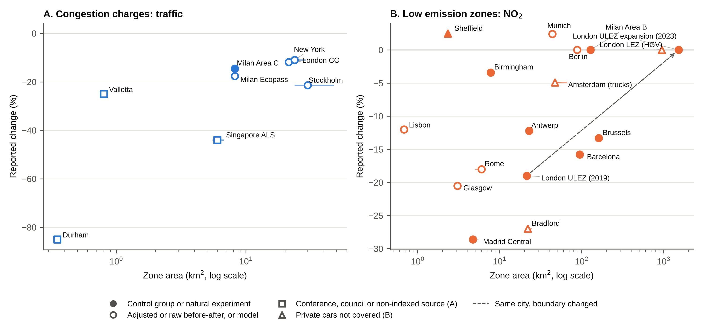

# S1. Inventory and search

**Inventory.** The starting point was a hand-compiled database of 65 urban road charging and access regulation schemes (Congestion Charging Database, compiled by Rose [full name and acknowledgement to add]). Rows were kept if they defined a bounded area that vehicles are charged or restricted for entering or circulating in. Removed: 20 linear motorway, expressway or bridge tolls, two point-based gantry charges (Singapore ERP, Dubai Salik), three plans or packages without a zone restriction (Derby, Nottingham, Southampton), two licence-plate rationing schemes without a bounded zone (Mexico City Hoy No Circula, Bogotá Pico y Placa) and one duplicate (Utrecht). Added because peer-reviewed evaluations exist: Stockholm, Gothenburg, Singapore Area Licensing Scheme, Valletta, Durham, Oslo, Milan Ecopass, London Western Extension, Rome, London LEZ for heavy vehicles, Lisbon, Antwerp, Brussels. Result: 50 zone-based schemes. Oxford's temporary congestion charge (from 29 October 2025, £5 a day for cars passing six charge points) was excluded because it charges at points rather than on entry to a bounded zone, and its pilot Zero Emission Zone has council monitoring only. Errors corrected in the source database are listed in the README of the deposited workbook (for example, the Beijing zone description had been copied from Berlin).

**Search.** This is a rapid review (Garritty et al., 2021). For each of the 50 schemes, one reviewer searched Google Scholar, Crossref and publisher sites in October and November 2026, combining the scheme name (and local name) with evaluation, traffic, air quality, NO2, PM10, difference-in-differences and synthetic control. Reference lists of Chamberlain et al. (2023), Holman et al. (2015) and Delgado-Lindeman et al. (2025) were screened. Working papers, preprints and agency reports were not used as effect sources except where flagged in Table S1. Every DOI was resolved through Crossref. Values first taken from secondary summaries were checked against the full texts for Milan Area C (Gibson & Carnovale, 2015, Beria, 2016), Antwerp and Brussels (Bruyneel et al., 2025) and the London Western Extension (Ding et al., 2022). Values for Barcelona (abstract and an institutional summary), Tassinari (2024), Danielis et al. (2012) and Givoni (2012) were taken from abstracts, working-paper or conference versions and are flagged in the extraction files.

**Extraction.** One row per scheme, outcome and measurement time. Fields: outcome metric, percentage change (negative = reduction), measurement location, years in operation at the midpoint of the evaluation window, design, spillover, citation and DOI. Where only an absolute change was reported, the percentage was computed against the baseline mean stated in the paper and flagged. Full extraction: 115 rows from 61 sources, 57 with a DOI (deposited files cc_effects.csv and lez_effects.csv).

# S2. Eligibility and departures from a systematic review

| Element | Include | Exclude |
|---|---|---|
| Population | Not applicable (the units are schemes, not people), any urban population | |
| Concept (intervention) | Urban schemes with a bounded zone that vehicles are charged or restricted for entering or circulating in: cordon or area congestion charges, toll rings, low emission zones, clean air zones, zero emission zones, limited traffic zones with emission or permit rules | Linear motorway, bridge or tunnel tolls, point-based gantry charging without a single boundary, licence-plate rationing without a zone, parking charges alone, national vehicle taxes |
| Outcomes | Ex-post quantitative change in traffic volume (crossings, counts, vehicle-km) or ambient pollutant concentration or emissions (NO2, NOx, PM10, PM2.5, black carbon) attributable to the scheme | Health outcomes without an exposure or traffic estimate, acceptability, revenue or equity outcomes only |
| Design | Any ex-post design: difference-in-differences, synthetic control, regression discontinuity in time, interrupted time series, before-after with or without reference sites, model-based attribution using observed data | Ex-ante or purely simulated scenarios, stated-preference studies |
| Context | Any country, 1975 to the search date | |
| Source | Peer-reviewed journal articles and refereed conference papers, any language with an English abstract | Working papers, preprints, theses, agency and council reports (recorded separately as grey literature, not charted as effect sources) |

Departures from a systematic review, following Garritty et al. (2021): (1) a scheme-by-scheme search of one academic search engine and Crossref replaced bibliographic database searches, (2) one reviewer searched, screened and charted, with full-text checks of key estimates, (3) no risk-of-bias tool was applied, and design type is reported as a descriptor, and (4) no meta-analysis was undertaken.

# S3. Charting and synthesis rules

Primary outcome: traffic volume for congestion charges (cordon crossings preferred, otherwise vehicle-km inside the zone) and NO₂ inside the zone for LEZs. PM10, PM2.5, black carbon and air quality rows for charges are secondary. Excluded from the headline set: spatial-contrast designs (Ding et al., 2022, which compares roads just inside and outside the Western Extension boundary and has no baseline year) and pooled multi-city estimates without a single zone size (German and Dutch panels, Table S8). The London Western Extension (2007 to 2011) was a temporary enlargement of the London charge and is analysed as an enlargement (Table S4, Figure 2) rather than as a separate scheme. Enlargements were included in Table S4 only where the original and the enlarged zone were evaluated on the same outcome (traffic or NO₂). Charge or rule changes, suspensions and removals are listed in Table S5, where the outcome is the one reported for the change (traffic, NO₂ or PM10).

Design types (charted as descriptors, not as a quality score): (1) untreated control group or natural experiment (difference-in-differences, synthetic control, regression discontinuity in time, interrupted time series with a control or natural experiment, namely Gibson and Carnovale 2015, Maranzano et al. 2020, Atkinson et al. 2009), (2) before-after adjusted for external factors without a control (interrupted time series without control, for example Börjesson and Kristoffersson 2018, Bryant et al. 2025, Hajmohammadi and Heydecker 2022), (3) before-after, raw or against a reference site, (4) model-based. Headline estimate per scheme phase: earliest duration band (under 1.5 years, 1.5 to under 4, 4 or more), then best design tier, then the median if several remain. Years in operation is the midpoint of the evaluation window, or the window end for cumulative trend estimates (Antwerp, Brussels). Persistence ratio: latest divided by earliest estimate for one metric from one source, for schemes with two or more measurement times.

Phases: schemes whose boundary changed were split into phases (the London ULEZ at its 2019 launch in central London and after its 2023 expansion to all of London, with no peer-reviewed estimate for the 2021 expansion to inner London). London's Low Emission Zone for heavy vehicles (from 2008) is a separate scheme from the ULEZ, giving 30 scheme phases. Rome's limited traffic zone is permit-based and is grouped with LEZs. Estimates reported only as not significant without a point estimate were charted as zero (Berlin NO₂, Gu et al., 2022, Milan Area B, Maranzano et al., 2020, London LEZ for heavy vehicles, Wood et al., 2015, 2023 ULEZ expansion, Tong et al., 2025, whose point estimates appear only in their supplementary tables and should be extracted). Other non-significant estimates kept their reported point values (Munich, Sheffield, Bradford).

Zone area rule: the area of the zone in which the effect was measured. This gives Lisbon Zone 1 (0.68 km²) for the Zone 1 NO₂ estimate. In Table S4 the enlarged zone is shown at its total area (38.4 km² for the London charge with the Western Extension, 25.14 km² for Lisbon Zones 1 and 2), although the London estimate was measured in the added 17 km² only. Table S9 shows the alternatives. Rome's −18% is paired with the 6 km² limited traffic zone. Cesaroni et al. (2012) report −4.13 and −2.99 µg/m³ for the two zones without labelling them in the abstract, and the pairing with the inner zone is inferred from their exposure results.

Size categories: street (under 1 km²), city centre (1 to under 10 km²), inner city (10 to under 50 km²), whole city (50 to under 500 km²) and metropolitan (500 km² or more), using the zone area defined above. The thresholds separate the orders of magnitude present in the data and are descriptive. Medians are reported with and without estimates charted as zero (Table S3). No estimates were pooled, because most categories hold five or fewer schemes and few sources report standard errors.

# S4. Size and stringency

Zone area: preferred value from the evaluation article, otherwise official documents, otherwise computed from an official boundary polygon (London Datastore, MTA, Glasgow City Council, Bradford Council, Lisbon City Council) or OpenStreetMap (Amsterdam 2008 truck zone, Antwerp) in an equal-area projection (EPSG:3035 or EPSG:27700). The range of published values is shown as horizontal bars in Figures S1 and S2. Denominator: urban centre area (field GC_UCA_KM2_2025) in GHS-UCDB R2024A version 1.2. Durham is not a UCDB urban centre, so its denominator is the GHS-SMOD R2023A dense urban cluster (13 km²), a different definition. Bradford lies inside the Leeds urban centre. The UCDB epoch is 2025 rather than the year each scheme began. No area could be recovered for the Bergen, Oslo and Trondheim toll rings as first introduced, or for Gothenburg. Charges and fines: local amount at launch inflated to 2023 with national CPI and divided by the 2023 PPP conversion factor (World Bank WDI). Charge relative to income: charge divided by one day's 2023 GDP per capita at PPP. Compliance at launch: share of entering, detected or registered vehicles meeting the standard at the start of the phase, from peer-reviewed or official monitoring sources, except Milan Ecopass (working paper, flagged). Four official zone areas (Birmingham, Sheffield, Munich, Milan Area B) were carried from the source database and not yet traced to the original document, and Madrid Central's 4.72 km² is the city council figure quoted in a preprint.

# Table S1. Headline estimates and sources

| Scheme | Outcome metric used | Effect (%) | Design | Source(s) | Evidence tier |
|---|---|---|---|---|---|
| Bergen | Traffic across toll ring in initial period | -6.5 | Before-after | Ieromonachou et al. (2007), doi:10.18757/ejtir.2007.7.1.3371 | secondary citation in journal review |
| Durham | Vehicles entering the Saddler Street charging zone per day | -85.0 | Before-after | May et al. (2010), doi:10.1007/s12544-010-0026-1 | council monitoring reported in journal review |
| Gothenburg | Median of 2 estimates, e.g. Traffic across cordon during charged hours 2013 vs 2012 | -11.4 | Before-after | Börjesson and Kristoffersson (2015), doi:10.1016/j.tra.2015.03.011 and Börjesson and Kristoffersson (2018), doi:10.1016/j.tra.2017.11.001 | journal article |
| London CC | Median of 2 estimates, e.g. Vehicle-km inside zone during charging hours (all vehicles) 2003 vs 2002 | -11.8 | Before-after | Givoni (2012), doi:10.1177/0042098011417017 and Green et al. (2016), doi:10.1016/j.jpubeco.2015.10.005 | journal article |
| Milan Area C | Daily vehicle entries into Area C attributable to the charge (natural experiment: court suspension 25 Jul to 17 Sep 2012, sign reversed) | -14.5 | Control or natural experiment | Gibson and Carnovale (2015), doi:10.1016/j.jue.2015.06.005 | journal article |
| Milan Ecopass | Median of 2 estimates, e.g. Vehicles entering the Ecopass zone (8 km2) nine months after launch vs pre-period | -17.6 | Before-after | Rotaris et al. (2010), doi:10.1016/j.tra.2010.03.008 and Danielis et al. (2012), doi:10.3280/EFE2012-002004 | journal article |
| New York | Overall vehicle entries into the CRZ Jan to Jun 2025 vs 2024 | -11.0 | Before-after | Fraser et al. (2025), doi:10.1038/s44407-025-00037-2 | journal article |
| Oslo | Traffic across toll cordon in first year | -4.0 | Before-after | Ieromonachou et al. (2005) | conference paper citing thesis |
| Singapore ALS | Inbound traffic (all vehicles) entering Restricted Zone during morning restricted hours immediately after ALS | -44.0 | Before-after | Fan (1995) | journal article without DOI (JEASTS 1995) |
| Stockholm | Traffic across cordon in charged hours adjusted to 2005 levels for external factors (employment, car ownership, fuel price) in 2006 | -21.4 | Adjusted before-after | Börjesson and Kristoffersson (2018), doi:10.1016/j.tra.2017.11.001 | journal article |
| Trondheim | Traffic across toll ring during charged hours after introduction | -10.0 | Before-after | Tretvik (2007) | conference paper (WCTR 2007) |
| Valletta | Morning peak traffic on St Anne Street (main approach) 2008 vs 2003 surveys | -25.0 | Before-after | Attard (2013) | conference paper (WCTR 2013) |
| Amsterdam (trucks) | Traffic contribution (roadside minus background) NO2 inside LEZ, adjusted for wind and traffic | -4.9 | Before-after | Panteliadis et al. (2014), doi:10.1016/j.atmosenv.2013.12.035 | journal article |
| Antwerp | Modelled annual residential NO2 inside LEZ, differential trend vs 10 Flemish control cities, cumulative 2016 to 2022 | -12.2 | Control or natural experiment | Bruyneel et al. (2025), doi:10.1016/j.envint.2025.109515 | journal article |
| Barcelona | NO2 at traffic stations inside ZBE vs synthetic control, 2020 to 2022 | -15.8 | Control or natural experiment | dos Santos et al. (2026), doi:10.1016/j.aeaoa.2026.100428 | journal article |
| Berlin | NO2 at traffic and background sites, GAMM | 0.0 | Before-after | Gu et al. (2022), doi:10.1016/j.jenvman.2021.114048 | journal article |
| Birmingham | Roadside NO2 inside CAZ vs augmented synthetic control, first year | -3.4 | Control or natural experiment | Liu et al. (2023), doi:10.1007/s10640-023-00794-2 | journal article |
| Bradford | City NO2 level change at Clean Air Plan implementation, ITS | -27.0 | Adjusted before-after | Bryant et al. (2025), doi:10.1016/j.envres.2025.120988 | journal article |
| Brussels | Modelled annual residential NO2 inside LEZ, differential trend vs Flemish and Walloon control cities, cumulative 2017 to 2022 | -13.3 | Control or natural experiment | Bruyneel et al. (2025), doi:10.1016/j.envint.2025.109515 | journal article |
| Glasgow | Median of 2 estimates, e.g. NO2 at High Street roadside, core weekdays, Aug-Sep 2022 vs Aug-Sep 2023 | -20.5 | Before-after | Shin et al. (2024), doi:10.32866/001c.123382 | journal article |
| Lisbon | Annual mean NO2, Zone 1 (city centre), 2009 to 2016 | -12.0 | Before-after | Santos et al. (2019), doi:10.1016/j.jhazmat.2018.11.061 | journal article |
| London LEZ (HGV) | Modelled annual NO2 at children's addresses, first three years | 0.0 | Before-after | Wood et al. (2015), doi:10.1371/journal.pone.0109121 | journal article |
| London ULEZ (2019) | Median of 5 estimates, e.g. Roadside NO2 vs synthetic control, 3 months | -19.0 | Control or natural experiment | Tong et al. (2025), doi:10.1038/s44407-025-00030-9 and Prieto-Rodriguez et al. (2022), doi:10.1016/j.tranpol.2022.10.010 | journal article |
| London ULEZ expansion (2023) | NO2 vs synthetic control, 3 months | 0.0 | Control or natural experiment | Tong et al. (2025), doi:10.1038/s44407-025-00030-9 | journal article |
| Madrid Central | Median of 2 estimates, e.g. NO2 at Plaza del Carmen (urban background, only station inside zone), DiD vs stations outside M30 and regional controls | -28.6 | Control or natural experiment | Salas et al. (2021), doi:10.1016/j.trd.2020.102689 and Gómez-Losada and Pires (2024), doi:10.1016/j.uclim.2024.101995 | journal article |
| Milan Area B | NO2 and NOx, unobserved components intervention model with neighbouring-city counterfactual, to Sep 2019 | 0.0 | Control or natural experiment | Maranzano et al. (2020), doi:10.3390/ijerph17031088 | journal article |
| Munich | NO2 at traffic sites, GAMM | 2.4 | Before-after | Gu et al. (2022), doi:10.1016/j.jenvman.2021.114048 | journal article |
| Rome | Additional modelled NO2 reduction in the two LEZs beyond citywide trend | -18.0 | Model | Cesaroni et al. (2012), doi:10.1136/oem.2010.063750 | journal article |
| Sheffield | De-weathered NO2 inside CAZ, DiD vs outside sites | 2.5 | Control or natural experiment | Williams et al. (2025), doi:10.1088/2515-7620/adf52f | journal article |

# Table S2. Zone areas, urban centre areas, charge and compliance sources

| Scheme | Zone (km²), preferred (min to max) | Zone area source | Urban centre (km²) | Charge or fine source | Compliance at launch (%) and source |
|---|---|---|---|---|---|
| Bergen |  | not available | 50 | Ieromonachou et al. (2007) EJTIR 7(1) (peer-reviewed) |  |
| Durham | 0.35 (0.35 to 0.35) | secondary: Ieromonachou et al. (2007) Table 1 | 13 | Ieromonachou et al. (2007) EJTIR 7(1), level unchanged later is grey (peer-reviewed) |  |
| Gothenburg |  | not available | 191 | Börjesson and Kristoffersson (2015) (peer-reviewed) |  |
| London CC | 21.4 (21 to 22) | computed from polygon (official TfL/GLA polygon, EPSG:3035 equal-area = 21.38 km2) | 1649 | Santos and Fraser (2006) Economic Policy 21(46) (peer-reviewed) |  |
| Milan Area C | 8.2 (7.95 to 8.2) | reported in peer-reviewed article | 785 | Beria (2016), resident and service rates from ITF-OECD Milan paper (grey, peer-reviewed) |  |
| Milan Ecopass | 8.2 (7.95 to 8.2) | reported in peer-reviewed article | 785 | Rotaris et al. (2010) Transp Res A 44(5), class table also in Danielis et al. Ecopass working paper (units.it) (grey, peer-reviewed) | 58, Danielis, Rotaris and Marcucci working paper "Ecopass 3 years later" Table 3 (AMAT official counts) (working paper) |
| New York | 23.8 (23.8 to 28.5) | computed from polygon (official MTA geofence, local Lambert azimuthal equal-area) | 3031 | MTA (official) |  |
| Oslo |  | not available | 244 | Ieromonachou et al. (2007) EJTIR 7(1) gives NOK 11, ERSA 2005 conference paper gives NOK 10 (grey, peer-reviewed) |  |
| Singapore ALS | 6 (5.59 to 6.7) | reported in academic book (no peer-reviewed article with the figure found) | 438 | National Library Board Singapore Infopedia "Area Licensing Scheme", Phang and Toh (1997, 2004) (official, peer-reviewed) |  |
| Stockholm | 30 (24 to 47) | reported in peer-reviewed article | 339 | Börjesson et al. (2012), Börjesson and Kristoffersson (2018) (peer-reviewed) |  |
| Trondheim |  | not available | 57 | Tretvik (2007, conference paper) |  |
| Valletta | 0.8 (0.8 to 0.84) | reported in peer-reviewed article | 100 | Attard and Ison (2010, peer-reviewed), Attard (2013, conference paper) |  |
| Amsterdam (trucks) | 47.2 (47.2 to 65.6) | computed from polygon (OSM current milieuzone polygon minus Noord district, local LAEA) | 308 | Dutch Parliament letter Kamerstuk 31305 nr. 87 (fine raised to EUR 150 on 1 May 2008) (official) |  |
| Antwerp | 22.9 (22.9 to 22.9) | computed from polygon (OSM relation, local LAEA) | 327 | VRT News (31 Jan 2018) |  |
| Barcelona | 95 (94.7 to 95) | reported in official document | 438 | 3Cat public broadcaster report on Barcelona ordinance |  |
| Berlin | 88 (87.2 to 88) | reported in official document | 681 | Bundestag Wissenschaftliche Dienste WD 8-056/21 (EUR 40 before May 2014), sticker mapping 35. BImSchV Annex 2 (official) |  |
| Birmingham | 7.77 (7.68 to 7.77) | reported in official document | 685 | Birmingham City Council CAZ six-month report (official) | 79.8, Birmingham City Council CAZ six-month report (2022) (official) |
| Bradford | 22 (22 to 24.2) | computed from polygon (official council polygon, EPSG:27700 and EPSG:3035) | 321 | Scheme table (council tariff) (grey) | 96.4, Bryant et al. (2025) (peer-reviewed) |
| Brussels | 161.4 (158.3 to 162.4) | reported in official document | 235 | Bruxelles Environnement, Évaluation de la LEZ 2018 (official) | 99.5, Bruxelles Environnement, Évaluation de la LEZ 2018 (official) |
| Glasgow | 3.06 (3.06 to 3.08) | computed from polygon (official council polygon, EPSG:27700 and EPSG:3035) | 309 | Glasgow City Council |  |
| Lisbon | 0.68 (0.68 to 0.68) | computed from polygon (official CML polygon, local LAEA, matches CML AREA_M2) | 426 | Ferreira et al. (2015) Atmospheric Environment for standards, fine not found (peer-reviewed) |  |
| London LEZ (HGV) | 1528.4 (1528.4 to 1572) | computed from polygon (official TfL/GLA polygon, EPSG:27700) | 1649 | TfL |  |
| London ULEZ (2019) | 21.4 (21 to 22) | computed from polygon (official TfL/GLA polygon, EPSG:3035) | 1649 | TfL (official) | 60.9, Tong et al. (2025) (peer-reviewed) |
| London ULEZ expansion (2023) | 1528.8 (1528.8 to 1572) | computed from polygon (official TfL/GLA polygon, EPSG:3035) | 1649 | TfL (official) | 92.6, Tong et al. (2025), entering vehicles |
| Madrid Central | 4.72 (4.47 to 4.72) | reported in official document | 680 | Stringency notes, fine amount not independently verified (grey) |  |
| Milan Area B | 128.29 (119.8 to 130.8) | reported in official document | 785 | Quattroruote guide (fine EUR 83), rules: Varesenews 2019 (grey, news) |  |
| Munich | 44 (44 to 44.6) | reported in official document | 345 | Bundestag WD 8-056/21 (official) |  |
| Rome | 6 (5.1 to 6) | reported in peer-reviewed article | 467 | Not verified |  |
| Sheffield | 2.33 (2.33 to 2.37) | reported in official document | 219 | Scheme table and notes (grey) |  |

# Table S3. Headline effects by zone size category

Median headline effect (%) by size category. Estimates reported only as not significant are charted as zero. Control is the number of schemes with an untreated control group or natural experiment.

| Type | Size category | n | Median (%) | Median without zeros (%) | Control | Schemes (effect %) |
|---|---|---|---|---|---|---|
| Charge (traffic) | Street (<1 km²) | 2 | −55.0 | −55.0 | 0 | Durham (−85.0), Valletta (−25.0) |
| Charge (traffic) | City centre (1 to 10 km²) | 3 | −17.6 | −17.6 | 1 | Milan Area C (−14.5), Milan Ecopass (−17.6), Singapore ALS (−44.0) |
| Charge (traffic) | Inner city (10 to 50 km²) | 3 | −11.8 | −11.8 | 0 | London CC (−11.8), New York (−11.0), Stockholm (−21.4) |
| LEZ (NO₂) | Street (<1 km²) | 1 | −12.0 | −12.0 | 0 | Lisbon (−12.0) |
| LEZ (NO₂) | City centre (1 to 10 km²) | 5 | −18.0 | −18.0 | 3 | Birmingham (−3.4), Glasgow (−20.5), Madrid Central (−28.6), Rome (−18.0), Sheffield (+2.5) |
| LEZ (NO₂) | Inner city (10 to 50 km²) | 5 | −12.2 | −12.2 | 2 | Amsterdam (trucks) (−4.9), Antwerp (−12.2), Bradford (−27.0), London ULEZ (2019) (−19.0), Munich (+2.4) |
| LEZ (NO₂) | Whole city (50 to 500 km²) | 4 | −6.7 | −14.6 | 3 | Barcelona (−15.8), Berlin (+0.0), Brussels (−13.3), Milan Area B (+0.0) |
| LEZ (NO₂) | Metropolitan (>500 km²) | 2 | 0.0 |  | 1 | London LEZ (HGV) (+0.0), London ULEZ expansion (2023) (+0.0) |

# Table S4. Original and enlarged zones in the same city (Figure 2)

| City and scheme | Outcome | Zone | Year | Area (km²) | Effect (%) | Design | Measured | Source | Note |
|---|---|---|---|---|---|---|---|---|---|
| London Congestion charge | Traffic | Central zone | 2003 | 21.4 | −11.8 | Before-after | Inside the central zone | Givoni (2012), doi:10.1177/0042098011417017 | Vehicle-km inside the zone in charging hours. |
| London Congestion charge | Traffic | Plus Western Extension | 2007 | 38.4 | −5.0 | DiD | Inside the added area (17 km²) | Ait Bihi Ouali et al. (2021), doi:10.1371/journal.pone.0253881 | Annual average daily flows. The extension was removed in 2011 with no significant change in total traffic in the former extension (same source). |
| London Ultra Low Emission Zone | NO₂ | Central London | 2019 | 21.4 | −19.6 | Synthetic control | Inside the central zone | Tong et al. (2025), doi:10.1038/s44407-025-00030-9 | Roadside NO2 after three months (the same window as the 2023 expansion estimate). 61% of entering vehicles compliant at launch. An inner London stage (2021) has no peer-reviewed estimate. |
| London Ultra Low Emission Zone | NO₂ | All of London | 2023 | 1,529 | 0 (not significant) | Synthetic control | Inside the expanded zone | Tong et al. (2025), doi:10.1038/s44407-025-00030-9 | Not significant for NO2. 92.6% of entering vehicles compliant at launch. |
| Lisbon Low emission zone | NO₂ | Zone 1 | 2011 | 0.68 | −12.0 | Before-after | Inside Zone 1 | Santos et al. (2019), doi:10.1016/j.jhazmat.2018.11.061 | Annual mean NO2 2009 to 2016. Zone 1 has the stricter standard (Euro 2 from 2012 and Euro 3 from 2015). |
| Lisbon Low emission zone | NO₂ | Zones 1 and 2 | 2012 | 25.14 | −22.0 | Before-after | Inside the Zone 2 ring | Santos et al. (2019), doi:10.1016/j.jhazmat.2018.11.061 | Annual mean NO2 2009 to 2016. Zone 2 has the looser standard (Euro 1 from 2012 and Euro 2 from 2015). |

# Table S5. Changes in charges or rules, suspensions and removals within a fixed boundary

| Change type | City | Change (year) | Outcome | Effect (%) | Earlier effect (%) | Design | Source |
|---|---|---|---|---|---|---|---|
| Rules changed (zone unchanged) | Milan | Ecopass emission-banded charge replaced by flat EUR 5 charge on all cars (Area C) (2012) | Traffic | −31.1 |  | Before-after | Beria (2016), doi:10.1080/15568318.2015.1083638. Entries 07:30 to 19:30 in 2012 against the Ecopass year 2011. City-wide traffic fell about 7% over the same period. |
| Rules changed (zone unchanged) | Milan | Area C charge raised from EUR 5 to EUR 7.50 (2023) | Traffic | −5.3 |  | RDD | Moulin and Urbano (2025), doi:10.1016/j.tranpol.2025.02.006. Ratio of vehicle entries to mobile-phone presences. |
| Rules changed (zone unchanged) | Stockholm | Peak charge raised 75% and bypass charged (2016) | Traffic | −5.1 |  | Before-after | Börjesson and Kristoffersson (2018), doi:10.1016/j.tra.2017.11.001. Peak cordon traffic March 2016 against October 2015. |
| Rules changed (zone unchanged) | Singapore | Charging extended to the evening peak (1989) | Traffic | −44.0 |  | Before-after | Fan (1995). Inbound traffic in the newly charged evening period. |
| Rules changed (zone unchanged) | Munich | LEZ tightened from stage 1 to stage 3 (green sticker only) (2012) | NO2 | −10.0 | +2.4 (Stage 1 (2008)) | Before-after | Gu et al. (2022), doi:10.1016/j.jenvman.2021.114048. Years in operation and tightening coincide. Gu et al. attribute less than half of the change to the zone. |
| Rules changed (zone unchanged) | Munich | Euro 4 and older diesel cars banned inside the LEZ (2023) | NO2 | −5.8 (not significant) |  | Synthetic control | Leibinger et al. (2024), doi:10.1016/j.envint.2024.109067. Not significant (95% CI −12.7 to 7.4 µg/m³ at the main site). |
| Rules changed (zone unchanged) | London | LEZ for heavy vehicles tightened (phase II) (2012) | PM10 | −5.5 | +14.8 (Phase I (2008)) | DiD | Zhai and Wolff (2021), doi:10.1007/s10018-021-00307-9. PM10 at roadside stations. Phase I increase attributed to exempt LGV and HGV traffic. |
| Scheme suspended or removed | Milan | Area C suspended by court order for eight weeks (2012) | Traffic | +14.5 |  | Natural experiment | Gibson and Carnovale (2015), doi:10.1016/j.jue.2015.06.005. Daily entries rose by about 27000 (14.5% of the mean). Traffic on the unpriced ring road fell. |
| Scheme suspended or removed | Trondheim | Toll ring removed (2005) | Traffic | +11.3 |  | Before-after | Meland et al. (2010), doi:10.1016/j.tranpol.2010.05.001. Former charged hours 06:00 to 18:00. County traffic grew 5.2% in the same year. |
| Scheme suspended or removed | London | Western Extension removed (2011) | Traffic | 0 (not significant) |  | DiD | Ait Bihi Ouali et al. (2021), doi:10.1371/journal.pone.0253881. No significant change in total traffic. HGV flows about +20%. |

# Table S6. German LEZs lifted between 2020 and 2025

| Zone (state) | Lifted | Basis stated in the official notice or report | Source type |
|---|---|---|---|
| Balingen (Baden-Württemberg) | November 2020 | State agency (LUBW) assessment confirming no limit exceedance | Press |
| Erfurt (Thuringia) | 2021 | Not stated in the source | NGO press release |
| Heidelberg, Karlsruhe, Pfinztal (Baden-Württemberg) | 2023 | LUBW assessment that no new exceedance would follow removal | Official |
| Schwäbisch Gmünd, Wendlingen am Neckar, Urbach, Ilsfeld (Baden-Württemberg) | 2023 | Air quality reports | Trade association, press |
| Heidenheim, Heilbronn, Herrenberg, Leonberg/Hemmingen (Baden-Württemberg) | 1 January 2024 | Ongoing monitoring below limit values | Official |
| Hannover (Lower Saxony) | 22 February 2024 | Not stated in the source | Press |
| Tübingen, Reutlingen, Ulm (Baden-Württemberg) | 2024 | LUBW assessment that the zones' effect on concentrations in 2024 was very small | Official |
| Neu-Ulm (Bavaria) | 2024 | Not stated in the source | Press |
| Mannheim, Mühlacker (Baden-Württemberg) | 1 August 2024 | Monitoring below limit values | Official |
| Freiburg im Breisgau (Baden-Württemberg) | 22 April 2025 | Not stated in the source | Press |
| Mainz (Rhineland-Palatinate) | 1 October 2025 | Improved air quality | Official |

Twenty-two zones in total. The Umweltbundesamt listed 37 remaining German LEZs at the time of access. We found no peer-reviewed ex-post evaluation of any of these removals in Google Scholar or Crossref searches combining Umweltzone, Aufhebung, low emission zone, removal and abolition.

# Table S7. Persistence ratios

| Scheme | First (years, effect %) | Last (years, effect %) | Ratio |
|---|---|---|---|
| Gothenburg | 0.5, -10.9 | 2.5, -9.6 | 0.88 |
| London CC | 0.5, -11.6 | 3.5, -14.0 | 1.21 |
| London ULEZ (2019) | 0.1, -19.6 | 0.5, -17.8 | 0.91 |
| Milan Ecopass | 0.5, -21.0 | 2.3, -16.0 | 0.76 |
| Munich | 1.0, 2.4 | 5.0, -10.0 | n/a (sign change) |
| Stockholm | 0.5, -21.4 | 5.5, -22.3 | 1.04 |

# Table S8. Pooled multi-city estimates (not in Figure 1)

| Estimate | Outcome | Effect (%) | Years | Design |
|---|---|---|---|---|
| German LEZ stage 1 (2008 cohort) | PM10 | -9.0 | 0.4 | DiD |
| German LEZs stages 1 to 3 (2008 to 2012) | PM10 | -4.0 | 2.0 | DiD |
| German LEZs stages 2 and 3 | NO2 | -3.4 | 2.0 | DiD |
| German LEZs stage 1 and stage 2 (25 cities, 2008 to 2009) | PM10 | -7.0 | 1.0 | DiD |
| German LEZs stage 1 (17 cities, 2008 to 2009) | NO2 | -4.0 | 1.0 | DiD |
| German LEZs stage 1 (19 cities, 2008 to 2009) | PM10 | -1.0 | 1.0 | DiD |
| German LEZs (58 zones, 2008 to 2016) | NO2 | -5.3 | 4.0 | DiD |
| German LEZs (58 zones, 2008 to 2016) | PM10 | -5.8 | 4.0 | DiD |
| German LEZs (43 cities, 2008 to 2016) | PM10 | -3.0 | 4.0 | DiD |
| German LEZs (58 zones, 2008 to 2018) | NO2 | -9.8 | 0.1 | RDD |
| German LEZs (58 zones, 2008 to 2018) | PM10 | -11.6 | 0.1 | RDD |
| Dutch truck LEZs and local traffic policies (2007 to 2008) | Black carbon | 0.0 | 2.0 | DiD |

# Table S9. Spearman rank correlations of headline effect with zone size or stringency

A positive ρ means larger values go with effects closer to zero (smaller reductions). Effect is negative for a reduction. These are descriptive, and p values are shown for reference only. Table S10 groups the LEZ estimates by coverage tercile instead.

| Analysis | Congestion charges (traffic) | Low emission zones (NO₂) |
|---|---|---|
| Relative coverage, all (main) | ρ = -0.563, n = 8, p = 0.146 | ρ = 0.371, n = 17, p = 0.142 |
| Absolute area (km²), all | ρ = 0.731, n = 8, p = 0.04 | ρ = 0.334, n = 17, p = 0.19 |
| Relative coverage, journal evidence only | ρ = -0.667, n = 5, p = 0.219 | ρ = 0.371, n = 17, p = 0.142 |
| Absolute area, journal evidence only | ρ = -0.051, n = 5, p = 0.935 | |
| Relative coverage, control or natural experiment only | n/a | ρ = 0.176, n = 9, p = 0.651 |
| Relative coverage, control or adjusted designs | n/a | ρ = 0.231, n = 10, p = 0.521 |
| Relative coverage, excluding Durham | ρ = -0.45, n = 7, p = 0.31 | |
| Absolute area, excluding Durham | ρ = 0.595, n = 7, p = 0.159 | |
| Absolute area, excluding Durham and Singapore | ρ = 0.406, n = 6, p = 0.425 | |
| Relative coverage, LEZs covering private cars | | ρ = 0.47, n = 13, p = 0.105 |
| Relative coverage, LEZs covering cars, control only | | ρ = 0.491, n = 8, p = 0.217 |
| Relative coverage, excluding four estimates reported only as not significant and charted as zero | | ρ = 0.159, n = 13, p = 0.603 |
| Relative coverage, excluding the 2023 ULEZ expansion | | ρ = 0.319, n = 16, p = 0.229 |
| Lisbon Zone 2 effect (−22%) with Zone 2 area (25.14 km²) | | ρ = 0.425, n = 17, p = 0.089 |
| As above, LEZs covering cars | | ρ = 0.613, n = 13, p = 0.026 |
| Charge relative to income vs effect | ρ = -0.434, n = 12, p = 0.159 | |
| Charge relative to income vs coverage | ρ = -0.18, n = 8, p = 0.67 | |
| Compliance at launch vs effect | | ρ = -0.1, n = 5, p = 0.873 |
| Compliance at launch vs coverage | | ρ = 0.6, n = 5, p = 0.285 |
| Start year vs coverage | | ρ = -0.117, n = 17, p = 0.654 |

# Table S10. LEZ headline effects by coverage tercile

| Tercile | n | Median effect (%) | Coverage range (%) | Schemes |
|---|---|---|---|---|
| small | 6 | -15.0 | 0.16 to 1.3 | Birmingham, Glasgow, Lisbon, Madrid Central, Rome, Sheffield |
| medium | 5 | -12.2 | 1.3 to 12.9 | Antwerp, Berlin, Bradford, London ULEZ (2019), Munich |
| large | 6 | -2.45 | 15.32 to 92.7 | Amsterdam (trucks), Barcelona, Brussels, London LEZ (HGV), London ULEZ expansion (2023), Milan Area B |

# Figure S1

![Figure S1. Headline effect against relative zone coverage (zone area as a share of the urban centre, log scale). (A) Congestion charges, change in traffic. (B) Low emission zones, change in NO₂ inside the zone. Filled markers have an untreated control group or natural experiment. Squares in (A) rest on conference papers, council data or a non-indexed journal, and triangles in (B) are zones that exempt private cars. Horizontal bars show the range of reported or computed zone areas. Dashed arrows join phases of the same city with different boundaries.](../figures/figS1_effect_vs_coverage.png)

# Figure S2

# Figure S3

# S5. Known limitations of the data

1. Single-reviewer searching, screening and charting is the main departure from a systematic review. Key estimates were checked against the full texts (S1), but a second reviewer has not verified the full extraction.
2. Six of the 13 charging schemes rest on conference papers, council data or a non-indexed journal, and all six are before-after comparisons. Both charges in the street category (Durham, Valletta) are among them.
3. Headline estimates mix measurement locations within each type (cordon crossings and vehicle-km for charges, roadside and background monitors for LEZs).
4. Several LEZ estimates come from modelled residential exposure (Antwerp, Brussels) or emissions models (Rome).
5. The London Western Extension has two conflicting estimates. The difference-in-differences estimate (−5%, Ait Bihi Ouali et al., 2021) is used and the spatial regression discontinuity (−31%, Ding et al., 2022) is excluded as not a change estimate.
6. Stockholm years in operation are counted from January 2006, although charging was suspended from August 2006 to July 2007.
7. Milan Area C's headline (−14.5%) is the court-suspension natural experiment (Gibson & Carnovale, 2015). Beria (2016) reports −31.1% against the Ecopass year 2011, with city-wide traffic about 7% lower over the same period.
8. Compliance at launch is known for five LEZs only. Brussels (99.5%) refers to the Brussels-registered fleet, and the Milan Ecopass figure comes from a working paper.
9. The urban centre denominator is the 2025 epoch, not the year each scheme began. Durham is not a UCDB urban centre and uses a GHS-SMOD dense urban cluster instead.
10. Within-city contrasts mix outcomes and designs. Munich's change from stage 1 to stage 3 coincides with more years in operation, and the Milan Ecopass to Area C change (Beria, 2016) is a raw comparison during which city-wide traffic also fell by about 7%.
11. The list of lifted German LEZs (Table S6) is compiled from official notices and press reports and may be incomplete.

# References cited only in the Supplementary Information

Fan, H. S. L. (1995). Car ownership demand and traffic congestion in Singapore's restricted zone. *Journal of the Eastern Asia Society for Transportation Studies*, 1(2), 603-611.

Zhai, M., & Wolff, H. (2021). Air pollution and urban road transport: Evidence from the world's largest low-emission zone in London. *Environmental Economics and Policy Studies*, 23, 721-748. https://doi.org/10.1007/s10018-021-00307-9

Grey sources for Table S6 (accessed 3 November 2026): Regierungspräsidium Stuttgart, press release of 29 December 2023 on lifting the Heidenheim, Heilbronn, Herrenberg and Leonberg/Hemmingen zones. Regierungspräsidium Karlsruhe, Luftreinhalteplan Fortschreibung 2022 (Heidelberg, Karlsruhe, Pfinztal) and public notice of 31 May 2024 (Mannheim, Mühlacker). Regierungspräsidium Tübingen, Luftreinhalteplan Tübingen, 3. Fortschreibung (April 2024), with corresponding updates for Reutlingen and Ulm. Umweltbundesamt, Umweltzonen in Deutschland (Mannheim and Mühlacker lifted 1 August 2024, 37 zones remaining). Landeshauptstadt Mainz, Umweltzone (lifted 1 October 2025). Deutsche Umwelthilfe, press release of 20 July 2022 (Erfurt). VWE (2024), Abolition of some German environmental zones (Schwäbisch Gmünd, Wendlingen am Neckar, Urbach, Ilsfeld, Tübingen, Reutlingen, Ulm). kfz-auskunft.de, Informatives zu Umweltzonen (Hannover, Freiburg). AutoScout24, Umweltzonen in Deutschland (Neu-Ulm). auto motor und sport, Wegfall der Umweltzonen (Balingen).

Attard, M., & Ison, S. G. (2010). The implementation of road user charging and the lessons learnt: The case of Valletta, Malta. *Journal of Transport Geography*, 18(1), 14-22. https://doi.org/10.1016/j.jtrangeo.2009.05.009

Delgado-Lindeman, M., et al. (2025). Characteristics and effects of low emission zones in Europe. A systematic literature review. *European Transport Research Review*, 17. https://doi.org/10.1186/s12544-025-00749-2

Phang, S. Y., & Toh, R. S. (1997). From manual to electronic road congestion pricing: The Singapore experience and experiment. *Transportation Research Part E: Logistics and Transportation Review*, 33(2), 97-106. https://doi.org/10.1016/S1366-5545(97)00006-9

Phang, S. Y., & Toh, R. S. (2004). Road congestion pricing in Singapore: 1975 to 2003. *Transportation Journal*, 43(2), 16-25.

Santos, G., & Fraser, G. (2006). Road pricing: Lessons from London. *Economic Policy*, 21(46), 264-310. https://doi.org/10.1111/j.1468-0327.2006.00159.x

Bruyneel, L., Cox, B., Stauffer, A., Vandenthoren, L., Fierens, F., Nawrot, T. S., & Horemans, C. (2025). Positive impact of the introduction of low-emission zones in Antwerp and Brussels on air quality, socio-economic disparities and health: A quasi-experimental study. *Environment International*, 199, 109515. https://doi.org/10.1016/j.envint.2025.109515

Ding, H., Li, H., & Sze, N. N. (2022). Effects of the abolishment of London western charging zone on traffic flow and vehicle emissions. *International Journal of Sustainable Transportation*, 16(6), 558-569. https://doi.org/10.1080/15568318.2021.1914790

Full citations for every effect estimate, including those cited only in S3 (Atkinson et al., 2009, Bryant et al., 2025, Cesaroni et al., 2012, Hajmohammadi and Heydecker, 2022, Maranzano et al., 2020, Tassinari, 2024), are given in the deposited extraction files (cc_effects.csv and lez_effects.csv), and those used as headline estimates also in Table S1.
