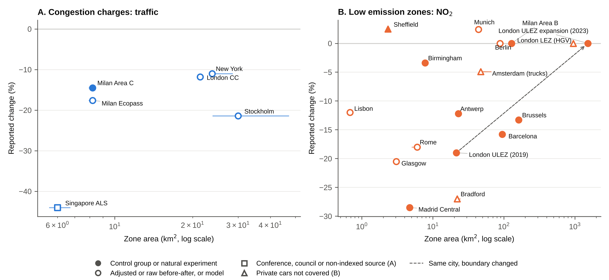

# S1. Inventory and search

**Inventory.** The starting point was a hand-compiled database of 65 urban road charging and access regulation schemes (Congestion Charging Database, compiled by Rose [full name and acknowledgement to add]). Rows were kept if they defined a bounded area that vehicles are charged or restricted for entering or circulating in. Removed: 20 linear motorway, expressway or bridge tolls, two point-based gantry charges (Singapore ERP, Dubai Salik), three plans or packages without a zone restriction (Derby, Nottingham, Southampton), two licence-plate rationing schemes without a bounded zone (Mexico City Hoy No Circula, Bogotá Pico y Placa) and one duplicate (Utrecht). Added because peer-reviewed evaluations exist: Stockholm, Gothenburg, Singapore Area Licensing Scheme, Valletta, Durham, Oslo, Milan Ecopass, London Western Extension, Rome, London LEZ for heavy vehicles, Lisbon, Antwerp, Brussels. Result: 50 zone-based schemes. Oxford's temporary congestion charge (from 29 October 2025, £5 a day for cars passing six charge points) was excluded because it charges at points rather than on entry to a bounded zone, and its pilot Zero Emission Zone has council monitoring only. Errors corrected in the source database are listed in the README of the deposited workbook (for example, the Beijing zone description had been copied from Berlin).

**Search.** This is a rapid review (Garritty et al., 2021). For each of the 50 schemes, one reviewer searched Google Scholar, Crossref and publisher sites in October and November 2026, combining the scheme name (and local name) with evaluation, traffic, air quality, NO2, PM10, difference-in-differences and synthetic control. Reference lists of Chamberlain et al. (2023), Holman et al. (2015) and Delgado-Lindeman et al. (2025) were screened. Working papers, preprints and agency reports were not used as effect sources except where flagged in Table S1. Every DOI was resolved through Crossref. Values first taken from secondary summaries were checked against the full texts for Milan Area C (Gibson & Carnovale, 2015, Beria, 2016), Antwerp and Brussels (Bruyneel et al., 2025) and the London Western Extension (Ding et al., 2022). Values for Barcelona (abstract and an institutional summary), Tassinari (2024), Danielis et al. (2012) and Givoni (2012) were taken from abstracts, working-paper or conference versions and are flagged in the extraction files.

**Second search for congestion charges (November 2026).** For each congestion charging city (London, Stockholm, Gothenburg, Milan, Singapore, New York, Oslo, Bergen, Trondheim, Valletta and Durham), peer-reviewed journal articles reporting ex-post changes in traffic or air quality were searched in Crossref, OpenAlex, Semantic Scholar and publisher pages. Working papers, preprints, conference papers, theses and agency reports were excluded. This added 36 rows from 16 articles (Table S12). The same search was then run for low emission zones (UK, southern Europe, France and Poland, Benelux and Germany, Asia, Latin America and Africa), adding 48 rows from 17 articles (Table S13). Street-specific diesel bans and city-wide licence-plate rationing were excluded because they have no bounded zone. Numbers were taken from abstracts or open full texts, and four Milan articles report only the direction of change in their abstracts.

**Extraction.** One row per scheme, outcome and measurement time. Fields: outcome metric, percentage change (negative = reduction), measurement location, years in operation at the midpoint of the evaluation window, design, spillover, citation and DOI. Where only an absolute change was reported, the percentage was computed against the baseline mean stated in the paper and flagged. Full extraction: 199 rows from 92 sources, 87 with a DOI (deposited files cc_effects.csv and lez_effects.csv).

# S2. Eligibility and departures from a systematic review

| Element | Include | Exclude |
|---|---|---|
| Population | Not applicable (the units are schemes, not people), any urban population | |
| Concept (intervention) | Urban schemes with a bounded zone that vehicles are charged or restricted for entering or circulating in: cordon or area congestion charges, toll rings, low emission zones, clean air zones, zero emission zones, limited traffic zones with emission or permit rules | Linear motorway, bridge or tunnel tolls, point-based gantry charging without a single boundary, licence-plate rationing without a zone, parking charges alone, national vehicle taxes |
| Outcomes | Ex-post quantitative change in traffic volume (crossings, counts, vehicle-km) or ambient pollutant concentration or emissions (NO2, NOx, PM10, PM2.5, black carbon) attributable to the scheme | Health outcomes without an exposure or traffic estimate, acceptability, revenue or equity outcomes only |
| Design | Any ex-post design: difference-in-differences, synthetic control, regression discontinuity in time, interrupted time series, before-after with or without reference sites, model-based attribution using observed data | Ex-ante or purely simulated scenarios, stated-preference studies |
| Context | Any country, 1975 to the search date | |
| Source | Peer-reviewed journal articles and refereed conference papers, any language with an English abstract | Working papers, preprints, theses, agency and council reports (recorded separately as grey literature, not charted as effect sources) |

Departures from a systematic review, following Garritty et al. (2021): (1) a scheme-by-scheme search of one academic search engine and Crossref replaced bibliographic database searches, (2) one reviewer searched, screened and charted, with full-text checks of key estimates, (3) no risk-of-bias tool was applied, and design type is reported as a descriptor, and (4) no meta-analysis was undertaken.

# S3. Charting and synthesis rules

Primary outcome: traffic volume for congestion charges (cordon crossings preferred, otherwise vehicle-km inside the zone) and NO₂ inside the zone for LEZs. PM10, PM2.5, black carbon and air quality rows for charges are secondary. Excluded from the analysis: Durham and Valletta, because their traffic estimates originate in council monitoring (Durham, reported in May et al. 2010) and a conference paper (Valletta, Attard 2013), and the only peer-reviewed Valletta source uses parked cars as a proxy for traffic (Attard and Ison 2015). Also excluded from the headline set: spatial-contrast designs (Ding et al., 2022, which compares roads just inside and outside the Western Extension boundary and has no baseline year) and pooled multi-city estimates without a single zone size (German and Dutch panels, Table S8). The London Western Extension (2007 to 2011) was a temporary enlargement of the London charge and is analysed as an enlargement (Table S4, Figure 2) rather than as a separate scheme. Enlargements were included in Table S4 only where the original and the enlarged zone were evaluated on the same outcome (traffic or NO₂). Charge or rule changes, suspensions and removals are listed in Table S5, where the outcome is the one reported for the change (traffic, NO₂ or PM10).

Design types (charted as descriptors, not as a quality score): (1) untreated control group or natural experiment (difference-in-differences, synthetic control, regression discontinuity in time, interrupted time series with a control or natural experiment, namely Gibson and Carnovale 2015, Maranzano et al. 2020, Atkinson et al. 2009), (2) before-after adjusted for external factors without a control (interrupted time series without control, for example Börjesson and Kristoffersson 2018, Bryant et al. 2025, Hajmohammadi and Heydecker 2022), (3) before-after, raw or against a reference site, (4) model-based. Headline estimate per scheme phase: earliest duration band (under 1.5 years, 1.5 to under 4, 4 or more), then best design tier, then the median if several remain. Years in operation is the midpoint of the evaluation window, or the window end for cumulative trend estimates (Antwerp, Brussels). Persistence ratio: latest divided by earliest estimate for one metric from one source, for schemes with two or more measurement times.

Phases: schemes whose boundary changed were split into phases (the London ULEZ at its 2019 launch in central London and after its 2023 expansion to all of London, with no peer-reviewed estimate for the 2021 expansion to inner London). London's Low Emission Zone for heavy vehicles (from 2008) is a separate scheme from the ULEZ, giving 30 scheme phases. Rome's limited traffic zone is permit-based and is grouped with LEZs. Estimates reported only as not significant without a point estimate were charted as zero (Berlin NO₂, Gu et al., 2022, Milan Area B, Maranzano et al., 2020, London LEZ for heavy vehicles, Wood et al., 2015, 2023 ULEZ expansion, Tong et al., 2025, whose point estimates appear only in their supplementary tables and should be extracted). Other non-significant estimates kept their reported point values (Munich, Sheffield, Bradford).

Zone area rule: the area of the zone in which the effect was measured. This gives Lisbon Zone 1 (0.68 km²) for the Zone 1 NO₂ estimate. In Table S4 the enlarged zone is shown at its total area (38.4 km² for the London charge with the Western Extension, 25.14 km² for Lisbon Zones 1 and 2), although the London estimate was measured in the added 17 km² only. Table S9 shows the alternatives. Rome's −18% is paired with the 6 km² limited traffic zone. Cesaroni et al. (2012) report −4.13 and −2.99 µg/m³ for the two zones without labelling them in the abstract, and the pairing with the inner zone is inferred from their exposure results.

Size categories: street (under 1 km²), city centre (1 to under 10 km²), inner city (10 to under 50 km²), whole city (50 to under 500 km²) and metropolitan (500 km² or more), using the zone area defined above. The thresholds separate the orders of magnitude present in the data and are descriptive. Medians are reported with and without estimates charted as zero (Table S3). No estimates were pooled, because most categories hold five or fewer schemes and few sources report standard errors.

# S4. Size and stringency

Zone area: preferred value from the evaluation article, otherwise official documents, otherwise computed from an official boundary polygon (London Datastore, MTA, Glasgow City Council, Bradford Council, Lisbon City Council) or OpenStreetMap (Amsterdam 2008 truck zone, Antwerp) in an equal-area projection (EPSG:3035 or EPSG:27700). The range of published values is shown as horizontal bars in Figures S1 and S2. Denominator: urban centre area (field GC_UCA_KM2_2025) in GHS-UCDB R2024A version 1.2. Durham is not a UCDB urban centre, so its denominator is the GHS-SMOD R2023A dense urban cluster (13 km²), a different definition. Bradford lies inside the Leeds urban centre. The UCDB epoch is 2025 rather than the year each scheme began. No area could be recovered for the Bergen, Oslo and Trondheim toll rings as first introduced, or for Gothenburg. Charges and fines: local amount at launch inflated to 2023 with national CPI and divided by the 2023 PPP conversion factor (World Bank WDI). Charge relative to income: charge divided by one day's 2023 GDP per capita at PPP. Compliance at launch: share of entering, detected or registered vehicles meeting the standard at the start of the phase, from peer-reviewed or official monitoring sources, except Milan Ecopass (working paper, flagged). Four official zone areas (Birmingham, Sheffield, Munich, Milan Area B) were carried from the source database and not yet traced to the original document, and Madrid Central's 4.72 km² is the city council figure quoted in a preprint.

# Table S1. Headline estimates and sources

| Scheme | Outcome metric used | Effect (%) | Design | Source(s) | Evidence tier |
|---|---|---|---|---|---|
| Bergen | Traffic across toll ring in initial period | -6.5 | Before-after | Ieromonachou et al. (2007), doi:10.18757/ejtir.2007.7.1.3371 | secondary citation in journal review |
| Gothenburg | Median of 2 estimates, e.g. Traffic across cordon during charged hours 2013 vs 2012 | -11.4 | Before-after | Börjesson and Kristoffersson (2015), doi:10.1016/j.tra.2015.03.011 and Börjesson and Kristoffersson (2018), doi:10.1016/j.tra.2017.11.001 | journal article |
| London CC | Median of 2 estimates, e.g. Vehicle-km inside zone during charging hours (all vehicles) 2003 vs 2002 | -11.8 | Before-after | Givoni (2012), doi:10.1177/0042098011417017 and Green et al. (2016), doi:10.1016/j.jpubeco.2015.10.005 | journal article |
| Milan Area C | Daily vehicle entries into Area C attributable to the charge (natural experiment: court suspension 25 Jul to 17 Sep 2012, sign reversed) | -14.5 | Control or natural experiment | Gibson and Carnovale (2015), doi:10.1016/j.jue.2015.06.005 | journal article |
| Milan Ecopass | Median of 2 estimates, e.g. Vehicles entering the Ecopass zone (8 km2) nine months after launch vs pre-period | -17.6 | Before-after | Rotaris et al. (2010), doi:10.1016/j.tra.2010.03.008 and Danielis et al. (2012), doi:10.3280/EFE2012-002004 | journal article |
| New York | Overall vehicle entries into the CRZ Jan to Jun 2025 vs 2024 | -11.0 | Before-after | Fraser et al. (2025), doi:10.1038/s44407-025-00037-2 | journal article |
| Oslo | Traffic across toll cordon in first year | -4.0 | Before-after | Ieromonachou et al. (2005) | conference paper citing thesis |
| Singapore ALS | Inbound traffic (all vehicles) entering Restricted Zone during morning restricted hours immediately after ALS | -44.0 | Before-after | Fan (1995) | journal article without DOI (JEASTS 1995) |
| Stockholm | Traffic across cordon in charged hours adjusted to 2005 levels for external factors (employment, car ownership, fuel price) in 2006 | -21.4 | Adjusted before-after | Börjesson and Kristoffersson (2018), doi:10.1016/j.tra.2017.11.001 | journal article |
| Trondheim | Traffic across toll ring during charged hours after introduction | -10.0 | Before-after | Tretvik (2007) | conference paper (WCTR 2007) |
| Amsterdam (trucks) | Traffic contribution (roadside minus background) NO2 inside LEZ, adjusted for wind and traffic | -4.9 | Before-after | Panteliadis et al. (2014), doi:10.1016/j.atmosenv.2013.12.035 | journal article |
| Antwerp | Modelled annual residential NO2 inside LEZ, differential trend vs 10 Flemish control cities, cumulative 2016 to 2022 | -12.2 | Control or natural experiment | Bruyneel et al. (2025), doi:10.1016/j.envint.2025.109515 | journal article |
| Barcelona | NO2 at traffic stations inside ZBE vs synthetic control, 2020 to 2022 | -15.8 | Control or natural experiment | dos Santos et al. (2026), doi:10.1016/j.aeaoa.2026.100428 | journal article |
| Berlin | NO2 at traffic and background sites, GAMM | 0.0 | Before-after | Gu et al. (2022), doi:10.1016/j.jenvman.2021.114048 | journal article |
| Birmingham | Roadside NO2 inside CAZ vs augmented synthetic control, first year | -3.4 | Control or natural experiment | Liu et al. (2023), doi:10.1007/s10640-023-00794-2 | journal article |
| Bradford | City NO2 level change at Clean Air Plan implementation, ITS | -27.0 | Adjusted before-after | Bryant et al. (2025), doi:10.1016/j.envres.2025.120988 | journal article |
| Brussels | Modelled annual residential NO2 inside LEZ, differential trend vs Flemish and Walloon control cities, cumulative 2017 to 2022 | -13.3 | Control or natural experiment | Bruyneel et al. (2025), doi:10.1016/j.envint.2025.109515 | journal article |
| Glasgow | Median of 2 estimates, e.g. NO2 at High Street roadside, core weekdays, Aug-Sep 2022 vs Aug-Sep 2023 | -20.5 | Before-after | Shin et al. (2024), doi:10.32866/001c.123382 | journal article |
| Lisbon | Annual mean NO2, Zone 1 (city centre), 2009 to 2016 | -12.0 | Before-after | Santos et al. (2019), doi:10.1016/j.jhazmat.2018.11.061 | journal article |
| London LEZ (HGV) | Modelled annual NO2 at children's addresses, first three years | 0.0 | Before-after | Wood et al. (2015), doi:10.1371/journal.pone.0109121 | journal article |
| London ULEZ (2019) | Median of 5 estimates, e.g. Roadside NO2 vs synthetic control, 3 months | -19.0 | Control or natural experiment | Tong et al. (2025), doi:10.1038/s44407-025-00030-9 and Prieto-Rodriguez et al. (2022), doi:10.1016/j.tranpol.2022.10.010 | journal article |
| London ULEZ expansion (2023) | NO2 vs synthetic control, 3 months | 0.0 | Control or natural experiment | Tong et al. (2025), doi:10.1038/s44407-025-00030-9 | journal article |
| Madrid Central | Median of 3 estimates, e.g. NO2 at Plaza del Carmen (urban background, only station inside zone), DiD vs stations outside M30 and regional controls | -28.5 | Control or natural experiment | Salas et al. (2021), doi:10.1016/j.trd.2020.102689 and Gómez-Losada and Pires (2024), doi:10.1016/j.uclim.2024.101995 and Galdon-Sanchez et al. (2023), doi:10.1093/jeea/jvac064 | journal article |
| Milan Area B | NO2 and NOx, unobserved components intervention model with neighbouring-city counterfactual, to Sep 2019 | 0.0 | Control or natural experiment | Maranzano et al. (2020), doi:10.3390/ijerph17031088 | journal article |
| Munich | NO2 at traffic sites, GAMM | 2.4 | Before-after | Gu et al. (2022), doi:10.1016/j.jenvman.2021.114048 | journal article |
| Rome | Additional modelled NO2 reduction in the two LEZs beyond citywide trend | -18.0 | Model | Cesaroni et al. (2012), doi:10.1136/oem.2010.063750 | journal article |
| Sheffield | De-weathered NO2 inside CAZ, DiD vs outside sites | 2.5 | Control or natural experiment | Williams et al. (2025), doi:10.1088/2515-7620/adf52f | journal article |

# Table S2. Zone areas, urban centre areas, charge and compliance sources

| Scheme | Zone (km²), preferred (min to max) | Zone area source | Urban centre (km²) | Charge or fine source | Compliance at launch (%) and source |
|---|---|---|---|---|---|
| Bergen |  | not available | 50 | Ieromonachou et al. (2007) EJTIR 7(1) (peer-reviewed) |  |
| Gothenburg |  | not available | 191 | Börjesson and Kristoffersson (2015) (peer-reviewed) |  |
| London CC | 21.4 (21 to 22) | computed from polygon (official TfL/GLA polygon, EPSG:3035 equal-area = 21.38 km2) | 1649 | Santos and Fraser (2006) Economic Policy 21(46) (peer-reviewed) |  |
| Milan Area C | 8.2 (7.95 to 8.2) | reported in peer-reviewed article | 785 | Beria (2016), resident and service rates from ITF-OECD Milan paper (grey, peer-reviewed) |  |
| Milan Ecopass | 8.2 (7.95 to 8.2) | reported in peer-reviewed article | 785 | Rotaris et al. (2010) Transp Res A 44(5), class table also in Danielis et al. Ecopass working paper (units.it) (grey, peer-reviewed) | 58, Danielis, Rotaris and Marcucci working paper "Ecopass 3 years later" Table 3 (AMAT official counts) (working paper) |
| New York | 23.8 (23.8 to 28.5) | computed from polygon (official MTA geofence, local Lambert azimuthal equal-area) | 3031 | MTA (official) |  |
| Oslo |  | not available | 244 | Ieromonachou et al. (2007) EJTIR 7(1) gives NOK 11, ERSA 2005 conference paper gives NOK 10 (grey, peer-reviewed) |  |
| Singapore ALS | 6 (5.59 to 6.7) | reported in academic book (no peer-reviewed article with the figure found) | 438 | National Library Board Singapore Infopedia "Area Licensing Scheme", Phang and Toh (1997, 2004) (official, peer-reviewed) |  |
| Stockholm | 30 (24 to 47) | reported in peer-reviewed article | 339 | Börjesson et al. (2012), Börjesson and Kristoffersson (2018) (peer-reviewed) |  |
| Trondheim |  | not available | 57 | Tretvik (2007, conference paper) |  |
| Amsterdam (trucks) | 47.2 (47.2 to 65.6) | computed from polygon (OSM current milieuzone polygon minus Noord district, local LAEA) | 308 | Dutch Parliament letter Kamerstuk 31305 nr. 87 (fine raised to EUR 150 on 1 May 2008) (official) |  |
| Antwerp | 22.9 (22.9 to 22.9) | computed from polygon (OSM relation, local LAEA) | 327 | VRT News (31 Jan 2018) |  |
| Barcelona | 95 (94.7 to 95) | reported in official document | 438 | 3Cat public broadcaster report on Barcelona ordinance |  |
| Berlin | 88 (87.2 to 88) | reported in official document | 681 | Bundestag Wissenschaftliche Dienste WD 8-056/21 (EUR 40 before May 2014), sticker mapping 35. BImSchV Annex 2 (official) |  |
| Birmingham | 7.77 (7.68 to 7.77) | reported in official document | 685 | Birmingham City Council CAZ six-month report (official) | 79.8, Birmingham City Council CAZ six-month report (2022) (official) |
| Bradford | 22 (22 to 24.2) | computed from polygon (official council polygon, EPSG:27700 and EPSG:3035) | 321 | Scheme table (council tariff) (grey) | 96.4, Bryant et al. (2025) (peer-reviewed) |
| Brussels | 161.4 (158.3 to 162.4) | reported in official document | 235 | Bruxelles Environnement, Évaluation de la LEZ 2018 (official) | 99.5, Bruxelles Environnement, Évaluation de la LEZ 2018 (official) |
| Glasgow | 3.06 (3.06 to 3.08) | computed from polygon (official council polygon, EPSG:27700 and EPSG:3035) | 309 | Glasgow City Council |  |
| Lisbon | 0.68 (0.68 to 0.68) | computed from polygon (official CML polygon, local LAEA, matches CML AREA_M2) | 426 | Ferreira et al. (2015) Atmospheric Environment for standards, fine not found (peer-reviewed) |  |
| London LEZ (HGV) | 1528.4 (1528.4 to 1572) | computed from polygon (official TfL/GLA polygon, EPSG:27700) | 1649 | TfL |  |
| London ULEZ (2019) | 21.4 (21 to 22) | computed from polygon (official TfL/GLA polygon, EPSG:3035) | 1649 | TfL (official) | 60.9, Tong et al. (2025) (peer-reviewed) |
| London ULEZ expansion (2023) | 1528.8 (1528.8 to 1572) | computed from polygon (official TfL/GLA polygon, EPSG:3035) | 1649 | TfL (official) | 92.6, Tong et al. (2025), entering vehicles |
| Madrid Central | 4.72 (4.47 to 4.72) | reported in official document | 680 | Stringency notes, fine amount not independently verified (grey) |  |
| Milan Area B | 128.29 (119.8 to 130.8) | reported in official document | 785 | Quattroruote guide (fine EUR 83), rules: Varesenews 2019 (grey, news) |  |
| Munich | 44 (44 to 44.6) | reported in official document | 345 | Bundestag WD 8-056/21 (official) |  |
| Rome | 6 (5.1 to 6) | reported in peer-reviewed article | 467 | Not verified |  |
| Sheffield | 2.33 (2.33 to 2.37) | reported in official document | 219 | Scheme table and notes (grey) |  |

# Table S3. Headline effects by zone size category

Median headline effect (%) by size category. Estimates reported only as not significant are charted as zero. Control is the number of schemes with an untreated control group or natural experiment.

| Type | Size category | n | Median (%) | Median without zeros (%) | Control | Schemes (effect %) |
|---|---|---|---|---|---|---|
| Charge (traffic) | City centre (1 to 10 km²) | 3 | −17.6 | −17.6 | 1 | Milan Area C (−14.5), Milan Ecopass (−17.6), Singapore ALS (−44.0) |
| Charge (traffic) | Inner city (10 to 50 km²) | 3 | −11.8 | −11.8 | 0 | London CC (−11.8), New York (−11.0), Stockholm (−21.4) |
| LEZ (NO₂) | Street (<1 km²) | 1 | −12.0 | −12.0 | 0 | Lisbon (−12.0) |
| LEZ (NO₂) | City centre (1 to 10 km²) | 5 | −18.0 | −18.0 | 3 | Birmingham (−3.4), Glasgow (−20.5), Madrid Central (−28.5), Rome (−18.0), Sheffield (+2.5) |
| LEZ (NO₂) | Inner city (10 to 50 km²) | 5 | −12.2 | −12.2 | 2 | Amsterdam (trucks) (−4.9), Antwerp (−12.2), Bradford (−27.0), London ULEZ (2019) (−19.0), Munich (+2.4) |
| LEZ (NO₂) | Whole city (50 to 500 km²) | 4 | −6.7 | −14.6 | 3 | Barcelona (−15.8), Berlin (+0.0), Brussels (−13.3), Milan Area B (+0.0) |
| LEZ (NO₂) | Metropolitan (>500 km²) | 2 | 0.0 |  | 1 | London LEZ (HGV) (+0.0), London ULEZ expansion (2023) (+0.0) |

# Table S4. Original and enlarged zones in the same city (Figure 2)

| City and scheme | Outcome | Zone | Year | Area (km²) | Effect (%) | Design | Measured | Source | Note |
|---|---|---|---|---|---|---|---|---|---|
| London Congestion charge | Traffic | Central zone | 2003 | 21.4 | −11.8 | Before-after | Inside the central zone | Givoni (2012), doi:10.1177/0042098011417017 | Vehicle-km inside the zone in charging hours. |
| London Congestion charge | Traffic | Plus Western Extension | 2007 | 38.4 | −5.0 | DiD | Inside the added area (17 km²) | Ait Bihi Ouali et al. (2021), doi:10.1371/journal.pone.0253881 | Annual average daily flows. The extension was removed in 2011 with no significant change in total traffic in the former extension (same source). |
| London Ultra Low Emission Zone | NO₂ | Central London | 2019 | 21.4 | −19.6 | Synthetic control | Inside the central zone | Tong et al. (2025), doi:10.1038/s44407-025-00030-9 | Roadside NO2 after three months (the same window as the 2023 expansion estimate). 61% of entering vehicles compliant at launch. An inner London stage (2021) has no peer-reviewed estimate. |
| London Ultra Low Emission Zone | NO₂ | All of London | 2023 | 1,529 | 0 (not significant) | Synthetic control | Inside the expanded zone | Tong et al. (2025), doi:10.1038/s44407-025-00030-9 | Not significant for NO2. 92.6% of entering vehicles compliant at launch. |
| Lisbon Low emission zone | NO₂ | Zone 1 | 2011 | 0.68 | −12.0 | Before-after | Inside Zone 1 | Santos et al. (2019), doi:10.1016/j.jhazmat.2018.11.061 | Annual mean NO2 2009 to 2016. Zone 1 has the stricter standard (Euro 2 from 2012 and Euro 3 from 2015). |
| Lisbon Low emission zone | NO₂ | Zones 1 and 2 | 2012 | 25.14 | −22.0 | Before-after | Inside the Zone 2 ring | Santos et al. (2019), doi:10.1016/j.jhazmat.2018.11.061 | Annual mean NO2 2009 to 2016. Zone 2 has the looser standard (Euro 1 from 2012 and Euro 2 from 2015). |

# Table S5. Changes in charges or rules, suspensions and removals within a fixed boundary

| Change type | City | Change (year) | Outcome | Effect (%) | Earlier effect (%) | Design | Source |
|---|---|---|---|---|---|---|---|
| Rules changed (zone unchanged) | Milan | Ecopass emission-banded charge replaced by flat EUR 5 charge on all cars (Area C) (2012) | Traffic | −31.1 |  | Before-after | Beria (2016), doi:10.1080/15568318.2015.1083638. Entries 07:30 to 19:30 in 2012 against the Ecopass year 2011. City-wide traffic fell about 7% over the same period. |
| Rules changed (zone unchanged) | Milan | Area C charge raised from EUR 5 to EUR 7.50 (2023) | Traffic | −5.3 |  | RDD | Moulin and Urbano (2025), doi:10.1016/j.tranpol.2025.02.006. Ratio of vehicle entries to mobile-phone presences. |
| Rules changed (zone unchanged) | Stockholm | Peak charge raised 75% and bypass charged (2016) | Traffic | −5.1 |  | Before-after | Börjesson and Kristoffersson (2018), doi:10.1016/j.tra.2017.11.001. Peak cordon traffic March 2016 against October 2015. |
| Rules changed (zone unchanged) | Singapore | Charging extended to the evening peak (1989) | Traffic | −44.0 |  | Before-after | Fan (1995). Inbound traffic in the newly charged evening period. |
| Rules changed (zone unchanged) | Munich | LEZ tightened from stage 1 to stage 3 (green sticker only) (2012) | NO2 | −10.0 | +2.4 (Stage 1 (2008)) | Before-after | Gu et al. (2022), doi:10.1016/j.jenvman.2021.114048. Years in operation and tightening coincide. Gu et al. attribute less than half of the change to the zone. |
| Rules changed (zone unchanged) | Munich | Euro 4 and older diesel cars banned inside the LEZ (2023) | NO2 | −5.8 (not significant) |  | Synthetic control | Leibinger et al. (2024), doi:10.1016/j.envint.2024.109067. Not significant (95% CI −12.7 to 7.4 µg/m³ at the main site). |
| Rules changed (zone unchanged) | London | LEZ for heavy vehicles tightened (phase II) (2012) | PM10 | −5.5 | +14.8 (Phase I (2008)) | DiD | Zhai and Wolff (2021), doi:10.1007/s10018-021-00307-9. PM10 at roadside stations. Phase I increase attributed to exempt LGV and HGV traffic. |
| Scheme suspended or removed | Milan | Area C suspended by court order for eight weeks (2012) | Traffic | +14.5 |  | Natural experiment | Gibson and Carnovale (2015), doi:10.1016/j.jue.2015.06.005. Daily entries rose by about 27000 (14.5% of the mean). Traffic on the unpriced ring road fell. |
| Scheme suspended or removed | Trondheim | Toll ring removed (2005) | Traffic | +11.3 |  | Before-after | Meland et al. (2010), doi:10.1016/j.tranpol.2010.05.001. Former charged hours 06:00 to 18:00. County traffic grew 5.2% in the same year. |
| Scheme suspended or removed | London | Western Extension removed (2011) | Traffic | 0 (not significant) |  | DiD | Ait Bihi Ouali et al. (2021), doi:10.1371/journal.pone.0253881. No significant change in total traffic. HGV flows about +20%. |

# Table S6. German LEZs lifted between 2020 and 2025

| Zone (state) | Lifted | Basis stated in the official notice or report | Source type |
|---|---|---|---|
| Balingen (Baden-Württemberg) | November 2020 | State agency (LUBW) assessment confirming no limit exceedance | Press |
| Erfurt (Thuringia) | 2021 | Not stated in the source | NGO press release |
| Heidelberg, Karlsruhe, Pfinztal (Baden-Württemberg) | 2023 | LUBW assessment that no new exceedance would follow removal | Official |
| Schwäbisch Gmünd, Wendlingen am Neckar, Urbach, Ilsfeld (Baden-Württemberg) | 2023 | Air quality reports | Trade association, press |
| Heidenheim, Heilbronn, Herrenberg, Leonberg/Hemmingen (Baden-Württemberg) | 1 January 2024 | Ongoing monitoring below limit values | Official |
| Hannover (Lower Saxony) | 22 February 2024 | Not stated in the source | Press |
| Tübingen, Reutlingen, Ulm (Baden-Württemberg) | 2024 | LUBW assessment that the zones' effect on concentrations in 2024 was very small | Official |
| Neu-Ulm (Bavaria) | 2024 | Not stated in the source | Press |
| Mannheim, Mühlacker (Baden-Württemberg) | 1 August 2024 | Monitoring below limit values | Official |
| Freiburg im Breisgau (Baden-Württemberg) | 22 April 2025 | Not stated in the source | Press |
| Mainz (Rhineland-Palatinate) | 1 October 2025 | Improved air quality | Official |

Twenty-two zones in total. The Umweltbundesamt listed 37 remaining German LEZs at the time of access. We found no peer-reviewed ex-post evaluation of any of these removals in Google Scholar or Crossref searches combining Umweltzone, Aufhebung, low emission zone, removal and abolition.

# Table S7. Persistence ratios

| Scheme | First (years, effect %) | Last (years, effect %) | Ratio |
|---|---|---|---|
| Gothenburg | 0.5, -10.9 | 2.5, -9.6 | 0.88 |
| London CC | 0.5, -11.6 | 3.5, -14.0 | 1.21 |
| London ULEZ (2019) | 0.1, -19.6 | 0.5, -17.8 | 0.91 |
| Milan Ecopass | 0.5, -21.0 | 2.3, -16.0 | 0.76 |
| Munich | 1.0, 2.4 | 5.0, -10.0 | n/a (sign change) |
| Stockholm | 0.5, -21.4 | 5.5, -22.3 | 1.04 |

# Table S8. Pooled multi-city estimates (not in Figure 1)

| Estimate | Outcome | Effect (%) | Years | Design |
|---|---|---|---|---|
| German LEZ stage 1 (2008 cohort) | PM10 | -9.0 | 0.4 | DiD |
| German LEZs stages 1 to 3 (2008 to 2012) | PM10 | -4.0 | 2.0 | DiD |
| German LEZs stages 2 and 3 | NO2 | -3.4 | 2.0 | DiD |
| German LEZs stage 1 and stage 2 (25 cities, 2008 to 2009) | PM10 | -7.0 | 1.0 | DiD |
| German LEZs stage 1 (17 cities, 2008 to 2009) | NO2 | -4.0 | 1.0 | DiD |
| German LEZs stage 1 (19 cities, 2008 to 2009) | PM10 | -1.0 | 1.0 | DiD |
| German LEZs (58 zones, 2008 to 2016) | NO2 | -5.3 | 4.0 | DiD |
| German LEZs (58 zones, 2008 to 2016) | PM10 | -5.8 | 4.0 | DiD |
| German LEZs (43 cities, 2008 to 2016) | PM10 | -3.0 | 4.0 | DiD |
| German LEZs (58 zones, 2008 to 2018) | NO2 | -9.8 | 0.1 | RDD |
| German LEZs (58 zones, 2008 to 2018) | PM10 | -11.6 | 0.1 | RDD |
| Dutch truck LEZs and local traffic policies (2007 to 2008) | Black carbon | 0.0 | 2.0 | DiD |
| German Umweltzonen, staggered adoption 2008 to 2019 (27 waves, all stages) | PM10 | -4.92 | 1.0 | DiD |
| German Umweltzonen, staggered adoption 2008 to 2019 (27 waves, all stages) | NO2 | -3.68 | 1.0 | DiD |

# Table S9. Spearman rank correlations of headline effect with zone size or stringency

A positive ρ means larger values go with effects closer to zero (smaller reductions). Effect is negative for a reduction. These are descriptive, and p values are shown for reference only. Table S10 groups the LEZ estimates by coverage tercile instead.

| Analysis | Congestion charges (traffic) | Low emission zones (NO₂) |
|---|---|---|
| Relative coverage, all (main) | ρ = -0.754, n = 6, p = 0.084 | ρ = 0.371, n = 17, p = 0.142 |
| Absolute area (km²), all | ρ = 0.406, n = 6, p = 0.425 | ρ = 0.334, n = 17, p = 0.19 |
| Relative coverage, journal evidence only | ρ = -0.667, n = 5, p = 0.219 | ρ = 0.371, n = 17, p = 0.142 |
| Absolute area, journal evidence only | ρ = -0.051, n = 5, p = 0.935 | |
| Relative coverage, control or natural experiment only | n/a | ρ = 0.176, n = 9, p = 0.651 |
| Relative coverage, control or adjusted designs | n/a | ρ = 0.231, n = 10, p = 0.521 |
| Relative coverage, excluding Durham | ρ = -0.754, n = 6, p = 0.084 | |
| Absolute area, excluding Durham | ρ = 0.406, n = 6, p = 0.425 | |
| Absolute area, excluding Durham and Singapore | ρ = -0.051, n = 5, p = 0.935 | |
| Relative coverage, LEZs covering private cars | | ρ = 0.47, n = 13, p = 0.105 |
| Relative coverage, LEZs covering cars, control only | | ρ = 0.491, n = 8, p = 0.217 |
| Relative coverage, excluding four estimates reported only as not significant and charted as zero | | ρ = 0.159, n = 13, p = 0.603 |
| Relative coverage, excluding the 2023 ULEZ expansion | | ρ = 0.319, n = 16, p = 0.229 |
| Lisbon Zone 2 effect (−22%) with Zone 2 area (25.14 km²) | | ρ = 0.425, n = 17, p = 0.089 |
| As above, LEZs covering cars | | ρ = 0.613, n = 13, p = 0.026 |
| Charge relative to income vs effect | ρ = -0.6, n = 10, p = 0.067 | |
| Charge relative to income vs coverage | ρ = -0.464, n = 6, p = 0.354 | |
| Compliance at launch vs effect | | ρ = -0.1, n = 5, p = 0.873 |
| Compliance at launch vs coverage | | ρ = 0.6, n = 5, p = 0.285 |
| Start year vs coverage | | ρ = -0.117, n = 17, p = 0.654 |

# Table S10. LEZ headline effects by coverage tercile

| Tercile | n | Median effect (%) | Coverage range (%) | Schemes |
|---|---|---|---|---|
| small | 6 | -15.0 | 0.16 to 1.3 | Birmingham, Glasgow, Lisbon, Madrid Central, Rome, Sheffield |
| medium | 5 | -12.2 | 1.3 to 12.9 | Antwerp, Berlin, Bradford, London ULEZ (2019), Munich |
| large | 6 | -2.45 | 15.32 to 92.7 | Amsterdam (trucks), Barcelona, Brussels, London LEZ (HGV), London ULEZ expansion (2023), Milan Area B |

# Table S11. Current charge or status of each scheme (November 2026)

Local currency. Effects in Table 1 were measured under the charge at launch, not under these prices.

| Scheme | Status | Current charge | Effective from | Source |
|---|---|---|---|---|
| DUR | In operation | GBP 5 a day |  | Durham Road User Charge Zone (Durham County Council) (official), https://durham.gov.uk/article/3437/Durham-Road-User-Charge-Zone |
| VAL | In operation | First 30 minutes free, then EUR 0.82 per hour, maximum EUR 6.52 |  | CVA Tariffs (cva.gov.mt) (official), https://cva.gov.mt/Page/Tariffs |
| Singapore ALS | Replaced by ERP (1998) |  | 1998-04-01 | Electronic Road Pricing system (Singapore Infopedia, National Library Board) (official), https://eresources.nlb.gov.sg/infopedia/articles/SIP_832__2009-01-05.html |
| Milan Ecopass | Replaced by Area C (2012) |  | 2012-01-16 | Come funziona la nuova Area C di Milano (Il Post) (press), https://www.ilpost.it/2012/01/04/come-funziona-la-nuova-area-c-di-milano/ |
| Milan Area C | In operation | EUR 7.50 a day | 2023-10-30 | Nuove tariffe 2023 Area C (Comune di Milano) (official), https://www.comune.milano.it/documents/20126/526561/nuove+tariffe+2023+Area+C.pdf |
| New York | In operation | USD 9 at peak for passenger cars with E-ZPass (USD 2.25 overnight) | 2025-01-05 | Congestion Relief Zone toll rates (MTA) (official), https://www.mta.info/document/138931 |
| London CC | In operation | GBP 18 a day | 2026-01-02 | TPH notice: changes to the Congestion Charge scheme (TfL) (official), https://content.tfl.gov.uk/02-26-tph-notice-changes-to-the-congestion-charge-scheme.pdf |
| Stockholm | In operation | SEK 45 per passage at peak (high season), SEK 135 a day cap |  | Trängselskatt i Stockholm, tider och belopp (Transportstyrelsen) (official), https://www.transportstyrelsen.se/sv/vagtrafik/Trangselskatt/Trangselskatt-i-Stockholm/tider-och-belopp/ |
| Gothenburg | In operation | SEK 22 per passage at peak, SEK 60 a day cap |  | Trängselskatt i Göteborg, tider och belopp (Transportstyrelsen) (official), https://www.transportstyrelsen.se/sv/vagtrafik/Trangselskatt/Trangselskatt-i-goteborg/tider-och-belopp/ |
| Oslo | In operation | NOK 47 per passage at rush hour for a petrol car (NOK 50 diesel) | 2026-01-01 | Tariffs and toll stations (Fjellinjen) (official), https://www.fjellinjen.no/en/tariffs-and-toll-stations |
| Bergen | In operation | NOK 64 per passage at rush hour for a petrol car (NOK 70 diesel) | 2026-01-01 | Bypakke Bergen 01.01.26 price adjustment (Ferde) (official), https://ferde.no/en/toll-station-news-and-updates/bypakke-bergen_01.01.26 |
| Trondheim | Ended (2005) | Original 1991 ring removed 2005, current Miljøpakken toll NOK 44 per passage at rush hour (NOK 22 off peak) |  | Bomsnitt Øst (MiljøØst), Miljøpakken Trondheim (Vegamot) (official), https://www.vegamot.no/takster-og-bomstasjoner/miljopakken-trondheim/bomsnitt-ost-miljoost/ |
| Lisbon | In operation | fine EUR 60 to 300 | 2015-01-15 (current phase) | Polícia Municipal de Lisboa não fiscalizou Zona de Emissões Reduzidas em cinco anos (RTP, 24 Jul 2025) (press), https://www.rtp.pt/noticias/pais/policia-municipal-de-lisboa-nao-fiscalizou-zona-de-emissoes-reduzidas-em-cinco-anos_a1671379 |
| Madrid Central | Replaced by ZBEDEP Distrito Centro (2021) | fine EUR 200 | 2021 (ZBEDEP), ordinance re-adopted March 2026 | Madrid lleva dos anos multando en ZBE pese a que el Supremo las declaro ilegales (Motorpasion, 29 Apr 2026) (press), https://www.motorpasion.com/seguridad/madrid-lleva-dos-anos-multando-zbe-pese-a-que-supremo-declaro-ilegales-ayuntamiento-dice-que-no-va-devolver-dinero/amp |
| Glasgow | In operation | penalty charge GBP 60 (first contravention) | 2023-06-01 | Pay / Appeal a LEZ Penalty Charge (Glasgow City Council) (official), https://www.glasgow.gov.uk/article/5719/Pay-Appeal-a-LEZ-Penalty-Charge |
| Sheffield | In operation | GBP 10 a day (vans, taxis), GBP 50 a day (HGVs, buses, coaches) |  | Clean Air Zone charges and how to pay (Sheffield City Council) (official), https://www.sheffield.gov.uk/clean-air-zone-sheffield/clean-air-zone-charges-and-how-pay |
| Birmingham | In operation | GBP 8 a day (cars, vans, taxis), GBP 50 a day (HGVs, buses, coaches) | 2021-06-14 | Pay a Clean Air Zone charge (Brum Breathes, Birmingham City Council) (official), https://www.brumbreathes.co.uk/info/32/charges-operation/34/paying-drive-clean-air-zone/2 |
| Rome | In operation | fine EUR 83 to 332 | 2001 (ZTL Centro Storico cameras) | Ztl Roma: orari 2026, mappa e permessi (SicurAuto, 19 Jan 2026) (press), https://www.sicurauto.it/news/attualita-e-curiosita/ztl-roma-orari-mappa-e-permessi/ |
| London ULEZ (2019) | In operation | GBP 12.50 a day (cars, vans, motorcycles) | 2019-04-08 | Ultra Low Emission Zone (Transport for London) (official), https://tfl.gov.uk/modes/driving/ultra-low-emission-zone |
| London ULEZ expansion (2023) | In operation | GBP 12.50 a day (cars, vans, motorcycles) | 2023-08-29 | Ultra Low Emission Zone (Transport for London) (official), https://tfl.gov.uk/modes/driving/ultra-low-emission-zone |
| Bradford | In operation | GBP 7 a day (taxis, PHVs), GBP 9 a day (LGVs, minibuses), GBP 50 a day (HGVs, buses, coaches) | 2022-09-26 | Frequently asked questions, Clean Air Zone (Bradford Council) (official), https://www.bradford.gov.uk/clean-air-zone/clean-air-zone-information/frequently-asked-questions |
| Antwerp | In operation | fine EUR 150 (first offence) | 2017-02-01 (LEZ start) | Low emission zones: what are they and what fines do drivers risk (Brussels Times, 10 Mar 2025) (press), https://www.brusselstimes.com/belgium/1472336/low-emission-zones-what-are-they-and-what-fines-do-drivers-risk/ |
| Munich | In operation | fine EUR 100 (plus fees) | Umweltzone 2008, whole Mittlerer Ring green sticker and Euro 4 diesel ban from 2023-02-01 | Umweltzone und Diesel-Fahrverbot in Muenchen (muenchen.de, updated 24 Feb 2026) (official), https://www.muenchen.de/verkehr/autos/umweltzone-und-diesel-fahrverbot-muenchen-alle-infos |
| Berlin | In operation | fine EUR 100 | 2008-01-01 | Umweltzone Berlin: Karte, Plakette, Strafen 2026 (Berlin Echo, Jul 2026) (press), https://berlinecho.de/umweltzone-berlin-karte-plakette-strafen-2026/ |
| Amsterdam (trucks) | In operation | fine EUR 310 (lorry) | 2009 (lorry zone), current fine level 2026 | Boete milieuzone (Unive, 2026) (press), https://www.unive.nl/autoverzekering/verkeersboetes/boete-milieuzone |
| Milan Area B | In operation | fine EUR 83 | 2019-02-25 | ZTL Milano 2026: guida ad Area B e Area C (Milanofree, updated 17 Oct 2026) (press), https://www.milanofree.it/milano/trasporti/ztl-milano-2026-guida-ad-area-b-e-area-c-orari-prezzi-e-divieti.html |
| Barcelona | In operation | fine EUR 200 (car), EUR 260 during pollution episodes | 2020-09-15 (sanctions), new ordinance 2023 | ZBE Barcelona: que coches pueden entrar, multas y excepciones (Barcelona Urbana, 22 Sep 2026) (press), https://barcelonaurbana.com/blog/zbe-barcelona-que-coches-pueden-entrar-multas-y-excepciones |
| Brussels | In operation | fine EUR 350 (once per quarter) | fines for 2025 stage vehicles from 2026-07-01 | LEZ Brussels (lez.brussels, Brussels Region) (official), https://www.lez.brussels/ |
| London LEZ (HGV) | In operation | GBP 100 a day (Euro IV PM but not Euro VI), GBP 300 a day (below Euro IV) |  | LEZ: make a payment (Transport for London) (official), https://tfl.gov.uk/modes/driving/low-emission-zone/make-a-payment |

# Table S12. Every congestion-charge estimate of traffic and air quality, by city

All peer-reviewed estimates charted for congestion charges, including those not used as headline estimates. "Direction only" means the abstract reports the direction of a significant change but no size that could be converted to a percentage. Use in this review follows the rules in S3.

| City | Scheme | Outcome | Measure | Effect (%) | Years in operation | Design | Use in this review | Source |
|---|---|---|---|---|---|---|---|---|
| London | London Congestion Charge (central zone 2003) | Traffic | Vehicle-km inside zone during charging hours (all vehicles) 2003 vs 2002 | −11.6 | 0.5 | Before-after | Headline candidate | Givoni (2012), doi:10.1177/0042098011417017 |
| London | London Congestion Charge (central zone 2003) | Traffic | Car and minicab distance driven inside zone (first year) and all-vehicle distance | −12.0 | 0.5 | Before-after | Headline candidate | Green et al. (2016), doi:10.1016/j.jpubeco.2015.10.005 |
| London | London Congestion Charge (central zone 2003) | Traffic | Traffic within charging zone, first year of operation vs pre-charge | −16.0 | 0.5 | Before-after | Secondary | Santos and Shaffer (2004), doi:10.1177/1087724X04268569 |
| London | London Congestion Charge (central zone 2003) | Traffic | Vehicle-km inside zone during charging hours (all vehicles) 2004 vs 2002 | −15.9 | 1.5 | Before-after | Headline candidate | Givoni (2012), doi:10.1177/0042098011417017 |
| London | London Congestion Charge (central zone 2003) | Traffic | Annual vehicle miles, all motor and non-motor categories, DfT counts inside zone vs control cities | −6.3 | 2.4 | Control or natural experiment | Headline candidate | Green et al. (2020), doi:10.1016/j.regsciurbeco.2020.103573 |
| London | London Congestion Charge (central zone 2003) | Traffic | Vehicle-km inside zone during charging hours (all vehicles) 2005 vs 2002 | −14.6 | 2.5 | Before-after | Headline candidate | Givoni (2012), doi:10.1177/0042098011417017 |
| London | London Congestion Charge (central zone 2003) | Traffic | Vehicle-km inside zone during charging hours (all vehicles) 2006 vs 2002 | −14.0 | 3.5 | Before-after | Headline candidate | Givoni (2012), doi:10.1177/0042098011417017 |
| London | London Congestion Charge (central zone 2003) | Traffic | Traffic flow (DfT AADF) in LSOAs inside zone after 2003 vs LSOAs within 2.5 km outside the boundary | −9.4 | 5.9 | Control or natural experiment | Headline candidate | Tang and van Ommeren (2022), doi:10.1093/jeg/lbab012 |
| London | London Congestion Charge (central zone 2003) | NO₂ | Measured NO2 at background monitors inside zone relative to control zone | direction only | 1.5 | Control or natural experiment | Not charted | Atkinson et al. (2009), doi:10.1016/j.atmosenv.2009.07.023 |
| London | London Congestion Charge (central zone 2003) | NO₂ | NO2 concentration at in-zone monitors during charging hours, 2003 to 2007 vs 2000 to 2002, relative to 20 UK control cities | +14.0 | 2.4 | Control or natural experiment | Secondary | Green et al. (2020), doi:10.1016/j.regsciurbeco.2020.103573 |
| London | London Congestion Charge (central zone 2003) | NOₓ | Road transport NOx emissions inside zone 2002 to 2003 (modelled from traffic and speed data) | −12.0 | 0.5 | Model-based | Secondary | Beevers and Carslaw (2005), doi:10.1016/j.atmosenv.2004.10.001 |
| London | London Congestion Charge (central zone 2003) | PM10 | PM10 concentration at in-zone monitors during charging hours, 2003 to 2007 vs 2000 to 2002, relative to 20 UK control cities | −22.0 | 2.4 | Control or natural experiment | Secondary | Green et al. (2020), doi:10.1016/j.regsciurbeco.2020.103573 |
| London | London Congestion Charge (central zone 2003) | CO | CO concentration at in-zone monitors during charging hours, 2003 to 2007 vs 2000 to 2002, relative to 20 UK control cities | −9.7 | 2.4 | Control or natural experiment | Secondary | Green et al. (2020), doi:10.1016/j.regsciurbeco.2020.103573 |
| London | London Congestion Charge (central zone, tightened rules from late 2015) | NO₂ | Annual NO2 (Defra modelled background, 500 m school buffers) inside CCZ 2016 to 2019 vs 2012 to 2015, relative to schools within 10 km outside | −4.8 | 14.4 | Control or natural experiment | Change to an existing scheme | Conte Keivabu and Rüttenauer (2022), doi:10.1007/s11111-022-00401-4 |
| London | London Congestion Charge (central zone, tightened rules from late 2015) | PM10 | Annual PM10 (Defra modelled background, school buffers) inside CCZ 2016 to 2019 vs 2012 to 2015, relative to schools within 10 km outside | −4.9 | 14.4 | Control or natural experiment | Change to an existing scheme | Conte Keivabu and Rüttenauer (2022), doi:10.1007/s11111-022-00401-4 |
| London | London Congestion Charge (central zone, tightened rules from late 2015) | PM2.5 | Annual PM2.5 (Defra modelled background, school buffers) inside CCZ 2016 to 2019 vs 2012 to 2015, relative to schools within 10 km outside | −5.6 | 14.4 | Control or natural experiment | Change to an existing scheme | Conte Keivabu and Rüttenauer (2022), doi:10.1007/s11111-022-00401-4 |
| London | London Western Extension (2007 to 2011) | Traffic | Traffic volume on 525 road sections in WEZ at introduction (spatial RDD at zone boundary, inside vs outside) | −31.0 | 0.5 | Control or natural experiment | Not charted | Ding et al. (2022), doi:10.1080/15568318.2021.1914790 |
| London | London Western Extension (2007 to 2011) | Traffic | Total motor vehicle AADF flows inside WEZ after introduction (Feb 2007) | −5.0 | 2.5 | Control or natural experiment | Headline candidate | Ait Bihi Ouali et al. (2021), doi:10.1371/journal.pone.0253881 |
| London | London Western Extension (2007 to 2011) | Traffic | Traffic volume on WEZ road sections after abolition (Jan 2011) | +26.0 | 3.9 | Control or natural experiment | Not charted | Ding et al. (2022), doi:10.1080/15568318.2021.1914790 |
| London | London Western Extension (2007 to 2011) | NOₓ | Traffic-related NOx emissions on WEZ road sections at introduction (modelled) | −29.0 | 0.5 | Control or natural experiment | Not charted | Ding et al. (2022), doi:10.1080/15568318.2021.1914790 |
| London | London Western Extension (2007 to 2011) | NOₓ | Traffic-related NOx emissions on WEZ road sections after abolition (Jan 2011), modelled from traffic | +24.0 | 3.9 | Control or natural experiment | Not charted | Ding et al. (2022), doi:10.1080/15568318.2021.1914790 |
| Stockholm | Stockholm congestion tax (2016 charge increase and bypass extension) | Traffic | Peak traffic across original cordon March 2016 vs October 2015 (after 75% peak charge rise) | −5.1 | 10.2 | Before-after | Change to an existing scheme | Börjesson and Kristoffersson (2018), doi:10.1016/j.tra.2017.11.001 |
| Stockholm | Stockholm congestion tax (end of green-vehicle exemption, 1 Jul 2012) | Traffic | Morning (06:30 to 12:00) weekday cordon crossings by previously exempt green-vehicle commuters, May to June 2013 vs 2012 | −32.8 | 5.8 | Before-after | Change to an existing scheme | Naqavi et al. (2023), doi:10.32866/001c.88878 |
| Stockholm | Stockholm congestion tax (permanent from Aug 2007) | Traffic | Traffic across cordon weekdays 06:00 to 19:00 vs 2005 (raw) | −21.0 | 0.3 | Before-after | Headline candidate | Börjesson et al. (2012), doi:10.1016/j.tranpol.2011.11.001 |
| Stockholm | Stockholm congestion tax (permanent from Aug 2007) | Traffic | Traffic across cordon in charged hours adjusted to 2005 levels for external factors (employment, car ownership, fuel price) in 2006 | −21.4 | 0.5 | Adjusted before-after | Headline candidate | Börjesson and Kristoffersson (2018), doi:10.1016/j.tra.2017.11.001 |
| Stockholm | Stockholm congestion tax (permanent from Aug 2007) | Traffic | Traffic across cordon weekdays 06:00 to 19:00 vs 2005 (raw) in 2007 (Aug to Dec) | −18.7 | 1.8 | Before-after | Headline candidate | Börjesson et al. (2012), doi:10.1016/j.tranpol.2011.11.001 |
| Stockholm | Stockholm congestion tax (permanent from Aug 2007) | Traffic | Traffic across cordon weekdays 06:00 to 19:00 vs 2005 (raw) in 2008 | −18.1 | 2.5 | Before-after | Headline candidate | Börjesson et al. (2012), doi:10.1016/j.tranpol.2011.11.001 |
| Stockholm | Stockholm congestion tax (permanent from Aug 2007) | Traffic | Traffic across cordon in charged hours adjusted for external factors in 2008 | −20.7 | 2.5 | Adjusted before-after | Headline candidate | Börjesson and Kristoffersson (2018), doi:10.1016/j.tra.2017.11.001 |
| Stockholm | Stockholm congestion tax (permanent from Aug 2007) | Traffic | Traffic across cordon weekdays 06:00 to 19:00 vs 2005 (raw) in 2011 | −20.1 | 5.5 | Before-after | Headline candidate | Börjesson et al. (2012), doi:10.1016/j.tranpol.2011.11.001 |
| Stockholm | Stockholm congestion tax (permanent from Aug 2007) | Traffic | Traffic across cordon in charged hours adjusted for external factors in 2011 | −22.3 | 5.5 | Adjusted before-after | Headline candidate | Börjesson and Kristoffersson (2018), doi:10.1016/j.tra.2017.11.001 |
| Stockholm | Stockholm congestion tax (permanent from Aug 2007) | NO₂ | Measured ambient NO2 in central Stockholm vs other Swedish central cities after permanent charge | −5.0 | 3.0 | Control or natural experiment | Secondary | Simeonova et al. (2021), doi:10.3368/jhr.56.4.0218-9363R2 |
| Stockholm | Stockholm congestion tax (trial 2006) | NOₓ | Total road traffic NOx emissions in charged inner city (modelled from traffic change) | −8.5 | 0.3 | Model-based | Secondary | Johansson et al. (2009), doi:10.1016/j.atmosenv.2008.09.015 |
| Stockholm | Stockholm congestion tax (trial 2006) | NOₓ | Annual mean ambient NOx concentration on most densely trafficked inner-city streets (dispersion model, permanent scheme) | −12.0 | 0.3 | Model-based | Secondary | Johansson et al. (2009), doi:10.1016/j.atmosenv.2008.09.015 |
| Stockholm | Stockholm congestion tax (trial 2006) | PM10 | Total road traffic PM10 emissions in charged inner city (modelled from traffic change) | −13.0 | 0.3 | Model-based | Secondary | Johansson et al. (2009), doi:10.1016/j.atmosenv.2008.09.015 |
| Stockholm | Stockholm congestion tax (trial 2006) | PM10 | Annual mean ambient PM10 concentration on most densely trafficked inner-city streets (dispersion model, permanent scheme) | −7.0 | 0.3 | Model-based | Secondary | Johansson et al. (2009), doi:10.1016/j.atmosenv.2008.09.015 |
| Stockholm | Stockholm congestion tax (trial Jan to Jul 2006) | Traffic | Vehicle passages across cordon during charged hours vs 2005 | −22.0 | 0.3 | Before-after | Headline candidate | Eliasson et al. (2009), doi:10.1016/j.tra.2008.09.007 |
| Stockholm | Stockholm congestion tax (trial Jan to Jul 2006) | Traffic | Road use (traffic) inside the charging cordon during trial | −15.0 | 0.3 | Before-after | Headline candidate | Johansson et al. (2009), doi:10.1016/j.atmosenv.2008.09.015 |
| Gothenburg | Gothenburg congestion tax (Jan 2013) | Traffic | Traffic across cordon during charged hours 2013 vs 2012 | −12.0 | 0.5 | Before-after | Headline candidate | Börjesson and Kristoffersson (2015), doi:10.1016/j.tra.2015.03.011 |
| Gothenburg | Gothenburg congestion tax (Jan 2013) | Traffic | Traffic across cordon in charged hours adjusted for national car traffic growth in 2013 | −10.9 | 0.5 | Before-after | Headline candidate | Börjesson and Kristoffersson (2018), doi:10.1016/j.tra.2017.11.001 |
| Gothenburg | Gothenburg congestion tax (Jan 2013) | Traffic | Traffic volume across cordon, whole day (24 h incl. non-charged hours), after vs before Jan 2013 | −10.0 | 0.5 | Before-after | Secondary | West and Börjesson (2020), doi:10.1007/s11116-017-9853-4 |
| Gothenburg | Gothenburg congestion tax (Jan 2013) | Traffic | Traffic across cordon in charged hours adjusted for national car traffic growth in 2014 | −9.5 | 1.5 | Before-after | Headline candidate | Börjesson and Kristoffersson (2018), doi:10.1016/j.tra.2017.11.001 |
| Gothenburg | Gothenburg congestion tax (Jan 2013) | Traffic | Traffic across cordon in charged hours adjusted for national car traffic growth in 2015 | −9.6 | 2.5 | Before-after | Headline candidate | Börjesson and Kristoffersson (2018), doi:10.1016/j.tra.2017.11.001 |
| Milan | Area C | Traffic | Entries of cars and some commercial vehicle types (gate counts by vehicle type) | direction only | 0.5 | Control or natural experiment | Not charted | Percoco (2015), doi:10.1007/s11116-014-9544-3 |
| Milan | Area C | Traffic | Entries of vehicle types whose access was banned | not significant | 0.5 | Control or natural experiment | Not charted | Percoco (2015), doi:10.1007/s11116-014-9544-3 |
| Milan | Area C | NOₓ | NOx concentration | not significant | 4.0 | Control or natural experiment | Not charted | Adam et al. (2026), doi:10.1002/env.70111 |
| Milan | Area C | PM10 | PM10 monthly mean concentration | direction only | 4.0 | Control or natural experiment | Not charted | Adam et al. (2026), doi:10.1002/env.70111 |
| Milan | Area C (2012 court suspension) | Traffic | Composition of vehicles entering the charged zone: Euro 0-3 vehicles | direction only | 0.5 | Before-after | Not charted | Percoco (2014), doi:10.1016/j.tranpol.2013.12.001 |
| Milan | Area C (2012 court suspension) | Traffic | Motorbike entries to the charged zone | direction only | 0.5 | Before-after | Not charted | Percoco (2014), doi:10.1016/j.tranpol.2013.12.001 |
| Milan | Ecopass | PM10 | PM10 (ARPA monitoring stations), before vs after enforcement | not significant | 0.5 | Before-after | Not charted | Ruprecht and Invernizzi (2009) |
| Milan | Ecopass | PM2.5 | PM1, PM2.5, PM10 (portable monitors on walking and car routes) | not significant | 0.5 | Before-after | Not charted | Ruprecht and Invernizzi (2009) |
| Milan | Ecopass | Other AQ | Pollutant concentrations, long-term effect (pollutants examined include those of Percoco 2013, not listed individually in abstract) | not significant | 0.6 | Control or natural experiment | Not charted | Percoco (2021), doi:10.1016/j.retrec.2020.100951 |
| Milan | Milan Area C (Jan 2012) | Traffic | Vehicle entries into Area C in 2012 vs 2011 (Ecopass period) | −31.1 | 0.5 | Before-after | Headline candidate | Beria (2016), doi:10.1080/15568318.2015.1083638 |
| Milan | Milan Area C (Jan 2012) | Traffic | Daily vehicle entries into Area C attributable to the charge (natural experiment: court suspension 25 Jul to 17 Sep 2012, sign reversed) | −14.5 | 0.6 | Control or natural experiment | Headline candidate | Gibson and Carnovale (2015), doi:10.1016/j.jue.2015.06.005 |
| Milan | Milan Area C (Jan 2012) | NO₂ | Simulated road-traffic NO2 emissions inside Area C, priced hours, 2012 vs 2011 | −25.0 | 0.5 | Model-based | Secondary | Beria (2016), doi:10.1080/15568318.2015.1083638 |
| Milan | Milan Area C (Jan 2012) | CO | Daily mean CO at monitors inside Area C attributable to the charge (suspension natural experiment, sign reversed) | −6.1 | 0.6 | Control or natural experiment | Secondary | Gibson and Carnovale (2015), doi:10.1016/j.jue.2015.06.005 |
| Milan | Milan Area C (Oct 2023 charge increase) | Traffic | Share of vehicle entries in mobility flows after charge rise EUR 5 to 7.50 | −5.3 | 11.8 | Control or natural experiment | Change to an existing scheme | Moulin and Urbano (2025), doi:10.1016/j.tranpol.2025.02.006 |
| Milan | Milan Ecopass (Jan 2008) | Traffic | Vehicles entering the Ecopass zone (8 km2) nine months after launch vs pre-period | −14.2 | 0.4 | Before-after | Headline candidate | Rotaris et al. (2010), doi:10.1016/j.tra.2010.03.008 |
| Milan | Milan Ecopass (Jan 2008) | Traffic | Daily vehicle entries 2008 vs 2007 (total vehicles) | −21.0 | 0.5 | Before-after | Headline candidate | Danielis et al. (2012), doi:10.3280/EFE2012-002004 |
| Milan | Milan Ecopass (Jan 2008) | Traffic | Daily vehicle entries 2009 vs 2007 (total vehicles) | −17.0 | 1.5 | Before-after | Headline candidate | Danielis et al. (2012), doi:10.3280/EFE2012-002004 |
| Milan | Milan Ecopass (Jan 2008) | Traffic | Daily vehicle entries Jan to Jun 2010 vs 2007 (total vehicles) | −16.0 | 2.3 | Before-after | Headline candidate | Danielis et al. (2012), doi:10.3280/EFE2012-002004 |
| Milan | Milan Ecopass (Jan 2008) | CO | Ambient CO and particulate concentrations after Ecopass introduction | direction only | 0.1 | Control or natural experiment | Not charted | Percoco (2013), doi:10.1016/j.trd.2013.09.004 |
| Singapore | Singapore Area Licensing Scheme (1989 evening extension) | Traffic | Total inbound traffic during new evening restricted period after Jun 1989 extension | −44.0 | 14.0 | Before-after | Change to an existing scheme | Fan (1995) |
| Singapore | Singapore Area Licensing Scheme (Jun 1975) | Traffic | Inbound traffic (all vehicles) entering Restricted Zone during morning restricted hours immediately after ALS | −44.0 | 0.1 | Before-after | Headline candidate | Fan (1995) |
| New York | New York Congestion Relief Zone (Jan 2025) | Traffic | Overall vehicle entries into the CRZ Jan to Jun 2025 vs 2024 | −11.0 | 0.3 | Before-after | Headline candidate | Fraser et al. (2025), doi:10.1038/s44407-025-00037-2 |
| New York | New York Congestion Relief Zone (Jan 2025) | PM2.5 | Daily maximum PM2.5 inside CRZ vs modelled counterfactual (first six months) | −22.0 | 0.3 | Control or natural experiment | Secondary | Fraser et al. (2025), doi:10.1038/s44407-025-00037-2 |
| New York | New York Congestion Relief Zone (Manhattan south of 60th St, 5 Jan 2025) | Traffic | Traffic volume (NYC DOT camera counts, computer vision) 8 weeks after launch vs same weekday and corresponding week in 2024 | −10.0 | 0.1 | Before-after | Secondary | Hu et al. (2026), doi:10.1038/s41893-026-01797-9 |
| New York | New York Congestion Relief Zone (Manhattan south of 60th St, 5 Jan 2025) | Traffic | Weekday TNC (Uber/Lyft) trips originating in CBD taxi zones, weeks 1-14 of 2025 vs 2024 | −6.0 | 0.2 | Control or natural experiment | Secondary | Pandey et al. (2026), doi:10.32866/001c.155761 |
| New York | New York Congestion Relief Zone (Manhattan south of 60th St, 5 Jan 2025) | NO₂ | Tropospheric NO2 column (TROPOMI) attributable to CBDTP, 2025 vs 2018-2024 | −1.2 | 1.0 | Control or natural experiment | Secondary | Goldberg et al. (2026), doi:10.1021/acs.estlett.6c00610 |
| New York | New York Congestion Relief Zone (Manhattan south of 60th St, 5 Jan 2025) | PM2.5 | PM2.5 at NYCCAS real-time monitors in CRZ, first year 2025 vs 2022-2024 (DiD) | not significant | 1.0 | Control or natural experiment | Not charted | Goldberg et al. (2026), doi:10.1021/acs.estlett.6c00610 |
| Oslo | Oslo toll ring (Feb 1990) | Traffic | Traffic across toll cordon in first year | −4.0 | 0.5 | Before-after | Headline candidate | Ieromonachou et al. (2005) |
| Bergen | Bergen toll ring (1986) with time-differentiated rush-hour charge (1 Feb 2016) | Traffic | Rush-hour vehicle crossings into city centre (toll stations) | −14.0 | 1.0 | Control or natural experiment | Change to an existing scheme | Isaksen and Johansen (2025), doi:10.1016/j.jeem.2025.103154 |
| Bergen | Bergen toll ring (1986) with time-differentiated rush-hour charge (1 Feb 2016) | Traffic | Daily vehicle crossings into city centre (toll stations) | −5.5 | 1.0 | Control or natural experiment | Change to an existing scheme | Isaksen and Johansen (2025), doi:10.1016/j.jeem.2025.103154 |
| Bergen | Bergen toll ring (1986) with time-differentiated rush-hour charge (1 Feb 2016) | NO₂ | NO2 daily mean at roadside monitors | −9.5 | 1.0 | Control or natural experiment | Change to an existing scheme | Isaksen and Johansen (2025), doi:10.1016/j.jeem.2025.103154 |
| Bergen | Bergen toll ring (1986) with time-differentiated rush-hour charge (1 Feb 2016) | NO₂ | NO2 during rush hours at roadside monitors | −11.0 | 1.0 | Control or natural experiment | Change to an existing scheme | Isaksen and Johansen (2025), doi:10.1016/j.jeem.2025.103154 |
| Bergen | Bergen toll ring (1986) with time-differentiated rush-hour charge (1 Feb 2016) | PM10 | PM10 daily mean at roadside monitors | −10.5 | 1.0 | Control or natural experiment | Change to an existing scheme | Isaksen and Johansen (2025), doi:10.1016/j.jeem.2025.103154 |
| Bergen | Bergen toll ring (Jan 1986) | Traffic | Traffic across toll ring in initial period | −6.5 | 0.5 | Before-after | Headline candidate | Ieromonachou et al. (2007), doi:10.18757/ejtir.2007.7.1.3371 |
| Trondheim | Trondheim toll ring (Oct 1991) | Traffic | Traffic across toll ring during charged hours after introduction | −10.0 | 0.5 | Before-after | Headline candidate | Tretvik (2007) |
| Trondheim | Trondheim toll ring (removed Dec 2005) | Traffic | Traffic across former cordon in former charged hours 06:00 to 18:00 in 2006 vs 2005 | +11.3 | 14.2 | Before-after | Removal or suspension | Meland et al. (2010), doi:10.1016/j.tranpol.2010.05.001 |
| Valletta | Valletta Controlled Vehicular Access (May 2007) | Traffic | Morning peak traffic on St Anne Street (main approach) 2008 vs 2003 surveys | −25.0 | 1.0 | Before-after | Not charted | Attard (2013) |
| Valletta | Valletta Controlled Vehicular Access (time-based road user charge, May 2007) | Traffic | Vehicles parked in Valletta on a typical weekday (parking survey, proxy for traffic) | −9.5 | 0.5 | Before-after | Not charted | Attard and Ison (2015), doi:10.1016/j.cstp.2014.07.001 |
| Valletta | Valletta Controlled Vehicular Access (time-based road user charge, May 2007) | Traffic | Vehicles parked in Valletta at peak time 10:00-11:00 (parking survey, proxy for traffic) | −26.7 | 0.5 | Before-after | Not charted | Attard and Ison (2015), doi:10.1016/j.cstp.2014.07.001 |
| Durham | Durham road user charge (Oct 2002) | Traffic | Vehicles entering the Saddler Street charging zone per day | −85.0 | 1.0 | Before-after | Not charted | May et al. (2010), doi:10.1007/s12544-010-0026-1 |

# Table S13. Every low emission zone estimate of traffic, fleet and air quality, by city

All peer-reviewed estimates charted for low emission zones, including those not used as headline estimates and schemes found in the November 2026 search that are outside the 50-scheme inventory (Ghent, Rotterdam, Stuttgart, Seville, Madrid's 2021 zone, Seoul and Greater Tokyo). Fleet rows are changes in the share or registration of non-compliant vehicles, not traffic volume.

| City | Scheme | Outcome | Measure | Effect (%) | Years in operation | Design | Use in this review | Source |
|---|---|---|---|---|---|---|---|---|
| London | LEZ for heavy vehicles (Feb 2008) | NO₂ | Modelled annual NO2 at children's addresses, first three years | +0.0 | 1.5 | Before-after | Headline candidate | Wood et al. (2015), doi:10.1371/journal.pone.0109121 |
| London | LEZ for heavy vehicles (Feb 2008) | NO₂ | Running annual mean NO2 at inner London roadside monitors, 2006 vs 2013 | −9.6 | 5.4 | Before-after | Secondary | Mudway et al. (2019), doi:10.1016/S2468-2667(18)30202-0 |
| London | LEZ for heavy vehicles (Feb 2008) | NOₓ | NOx inside zone vs outside | +0.0 | 2.5 | Before-after | Secondary | Ellison et al. (2013), doi:10.1016/j.trd.2013.03.010 |
| London | LEZ for heavy vehicles (Feb 2008) | PM10 | Ambient PM inside zone vs just outside, five years | −2.8 | 2.5 | Before-after | Secondary | Ellison et al. (2013), doi:10.1016/j.trd.2013.03.010 |
| London | LEZ for heavy vehicles (Feb 2008) | PM10 | Measured PM10 trend at London monitors, 2008 to 2013 | not significant | 2.9 | Before-after | Not charted | Mudway et al. (2019), doi:10.1016/S2468-2667(18)30202-0 |
| London | LEZ for heavy vehicles (Feb 2008), phase I | PM10 | Roadside PM10 inside zone, stepwise DiD | +14.8 | 0.5 | Control or natural experiment | Secondary | Zhai and Wolff (2021), doi:10.1007/s10018-021-00307-9 |
| London | LEZ for heavy vehicles (Feb 2008), phase II | PM10 | Roadside PM10 inside zone, stepwise DiD | −5.5 | 2.0 | Control or natural experiment | Secondary | Zhai and Wolff (2021), doi:10.1007/s10018-021-00307-9 |
| London | ULEZ Greater London (Aug 2023) | NO₂ | NO2 vs synthetic control, 3 months | +0.0 | 0.1 | Control or natural experiment | Headline candidate | Tong et al. (2025), doi:10.1038/s44407-025-00030-9 |
| London | ULEZ central (Apr 2019) | Fleet | Share of non-compliant vehicles detected in central London zone, Mar 2019 vs Sep 2019 | −34.0 | 0.4 | Before-after | Secondary | Tong et al. (2025), doi:10.1038/s44407-025-00030-9 |
| London | ULEZ central (Apr 2019) | NO₂ | Roadside NO2 vs synthetic control, 3 months | −19.6 | 0.1 | Control or natural experiment | Headline candidate | Tong et al. (2025), doi:10.1038/s44407-025-00030-9 |
| London | ULEZ central (Apr 2019) | NO₂ | Urban background NO2 vs synthetic control, 3 months | −8.2 | 0.1 | Control or natural experiment | Headline candidate | Tong et al. (2025), doi:10.1038/s44407-025-00030-9 |
| London | ULEZ central (Apr 2019) | NO₂ | NO2, all London sites, regression discontinuity in time | −3.0 | 0.4 | Control or natural experiment | Secondary | Ma et al. (2021), doi:10.1088/1748-9326/ac30c1 |
| London | ULEZ central (Apr 2019) | NO₂ | Roadside NO2 inside Congestion Charge Zone, DiD vs outer London controls | −19.0 | 0.4 | Control or natural experiment | Headline candidate | Prieto-Rodriguez et al. (2022), doi:10.1016/j.tranpol.2022.10.010 |
| London | ULEZ central (Apr 2019) | NO₂ | Urban background NO2 inside Congestion Charge Zone, DiD | −19.3 | 0.4 | Control or natural experiment | Headline candidate | Prieto-Rodriguez et al. (2022), doi:10.1016/j.tranpol.2022.10.010 |
| London | ULEZ central (Apr 2019) | NO₂ | Roadside NO2 vs synthetic control, 11 months | −17.8 | 0.5 | Control or natural experiment | Headline candidate | Tong et al. (2025), doi:10.1038/s44407-025-00030-9 |
| London | ULEZ central (Apr 2019) | NO₂ | NO2 state-space intervention effect, ULEZ area, 11 months | −11.5 | 0.5 | Adjusted before-after | Headline candidate | Hajmohammadi and Heydecker (2022), doi:10.1016/j.apr.2022.101514 |
| London | ULEZ central (Apr 2019) | NO₂ | Modelled annual residential NO2 of CHILL cohort children, London (ULEZ) vs Luton, annual rate of change over 4-year follow-up | direction only | 2.0 | Model-based | Not charted | Wood et al. (2026), doi:10.1016/S2468-2667(26)00163-5 |
| London | ULEZ central (Apr 2019) | NOₓ | Roadside NOx at central London traffic sites vs synthetic control, 3 months | −28.8 | 0.1 | Control or natural experiment | Secondary | Tong et al. (2025), doi:10.1038/s44407-025-00030-9 |
| London | ULEZ central (Apr 2019) | NOₓ | Urban background NOx in central London vs synthetic control, 3 months | −6.6 | 0.1 | Control or natural experiment | Secondary | Tong et al. (2025), doi:10.1038/s44407-025-00030-9 |
| London | ULEZ central (Apr 2019) | NOₓ | Roadside NOx at central London traffic sites vs synthetic control, 11 months | −24.2 | 0.5 | Control or natural experiment | Secondary | Tong et al. (2025), doi:10.1038/s44407-025-00030-9 |
| London | ULEZ central (Apr 2019) | PM2.5 | Roadside PM2.5 vs synthetic control, 3 months | −12.7 | 0.1 | Control or natural experiment | Secondary | Tong et al. (2025), doi:10.1038/s44407-025-00030-9 |
| London | ULEZ central (Apr 2019) | PM2.5 | PM2.5, all London sites, regression discontinuity in time | +0.0 | 0.4 | Control or natural experiment | Secondary | Ma et al. (2021), doi:10.1088/1748-9326/ac30c1 |
| Birmingham | Clean Air Zone class D (Jun 2021) | Fleet | Share of non-compliant vehicles in CAZ, 1-13 Jun 2021 vs Aug 2021 | −29.4 | 0.2 | Before-after | Secondary | Liu et al. (2023), doi:10.1007/s10640-023-00794-2 |
| Birmingham | Clean Air Zone class D (Jun 2021) | NO₂ | Roadside NO2 inside CAZ vs augmented synthetic control, first year | −3.4 | 0.5 | Control or natural experiment | Headline candidate | Liu et al. (2023), doi:10.1007/s10640-023-00794-2 |
| Birmingham | Clean Air Zone class D (Jun 2021) | NOₓ | Roadside NOx inside CAZ vs augmented synthetic control, first year | −5.4 | 0.5 | Control or natural experiment | Secondary | Liu et al. (2023), doi:10.1007/s10640-023-00794-2 |
| Birmingham | Clean Air Zone class D (Jun 2021) | PM2.5 | PM2.5 inside CAZ vs synthetic control, first year | +0.0 | 0.5 | Control or natural experiment | Secondary | Liu et al. (2023), doi:10.1007/s10640-023-00794-2 |
| Bradford | Clean Air Zone class C+ within Clean Air Plan (Sep 2022) | NO₂ | City NO2 level change at Clean Air Plan implementation, ITS | −27.0 | 0.5 | Adjusted before-after | Headline candidate | Bryant et al. (2025), doi:10.1016/j.envres.2025.120988 |
| Glasgow | Glasgow LEZ (enforced Jun 2023) | Traffic | Daily traffic flow at High Street, core weekdays | −16.0 | 0.3 | Before-after | Secondary | Shin et al. (2024), doi:10.32866/001c.123382 |
| Glasgow | Glasgow LEZ (enforced Jun 2023) | NO₂ | NO2 at High Street roadside, core weekdays, Aug-Sep 2022 vs Aug-Sep 2023 | −28.0 | 0.3 | Before-after | Headline candidate | Shin et al. (2024), doi:10.32866/001c.123382 |
| Glasgow | Glasgow LEZ (enforced Jun 2023) | NO₂ | NO2 at Hope Street roadside, core weekdays | −13.0 | 0.3 | Before-after | Headline candidate | Shin et al. (2024), doi:10.32866/001c.123382 |
| Sheffield | Clean Air Zone class C (Feb 2023) | Traffic | Traffic volume, 33 sensors inside and around CAZ | +0.0 | 0.7 | Before-after | Secondary | Williams et al. (2025), doi:10.1088/2515-7620/adf52f |
| Sheffield | Clean Air Zone class C (Feb 2023) | NO₂ | De-weathered NO2 inside CAZ, DiD vs outside sites | +2.5 | 0.7 | Control or natural experiment | Headline candidate | Williams et al. (2025), doi:10.1088/2515-7620/adf52f |
| Sheffield | Clean Air Zone class C (Feb 2023) | PM2.5 | De-weathered PM2.5 inside CAZ, DiD | +0.0 | 0.7 | Control or natural experiment | Secondary | Williams et al. (2025), doi:10.1088/2515-7620/adf52f |
| Amsterdam | Amsterdam LEZ for trucks (2009) | NO₂ | Traffic contribution (roadside minus background) NO2 inside LEZ, adjusted for wind and traffic | −4.9 | 1.0 | Before-after | Headline candidate | Panteliadis et al. (2014), doi:10.1016/j.atmosenv.2013.12.035 |
| Amsterdam | Amsterdam LEZ for trucks (2009) | PM10 | Traffic contribution PM10 inside LEZ | −5.8 | 1.0 | Before-after | Secondary | Panteliadis et al. (2014), doi:10.1016/j.atmosenv.2013.12.035 |
| Amsterdam | Amsterdam LEZ for trucks (2009) | Black carbon | Traffic contribution elemental carbon inside LEZ | −12.9 | 1.0 | Before-after | Secondary | Panteliadis et al. (2014), doi:10.1016/j.atmosenv.2013.12.035 |
| Rotterdam | Rotterdam LEZ for passenger cars and vans (2016) | Traffic | Number of polluting passenger cars and vans (diesel E0-E3, petrol E0) entering the LEZ, 2016-2017 vs 2015 | −50.0 | 1.0 | Before-after | Secondary | Attia et al. (2023), doi:10.3390/su15097443 |
| Rotterdam | Rotterdam LEZ for passenger cars and vans (2016) | Traffic | Overall transport network usage by mode (car traffic volume), 2016-2020 vs 2011-2015 | not significant | 2.0 | Before-after | Not charted | Attia et al. (2023), doi:10.3390/su15097443 |
| Netherlands (five cities incl. Amsterdam and Utrecht) | Dutch truck LEZs and local traffic policies (2007 to 2008) | Black carbon | Street-level soot 2008 vs 2010 at intervention streets vs suburban controls | +0.0 | 2.0 | Control or natural experiment | nan | Boogaard et al. (2012), doi:10.1016/j.scitotenv.2012.06.089 |
| Antwerp | Antwerp LEZ (Feb 2017) | NO₂ | Trend in surface NO2 (satellite plus in-situ) inside LEZ relative to other urban and suburban areas, 2019 to 2024 | direction only | 4.9 | Control or natural experiment | Not charted | Verhoelst et al. (2025), doi:10.1016/j.atmosenv.2025.121447 |
| Antwerp | Antwerp LEZ (Feb 2017) | NO₂ | Modelled annual residential NO2 inside LEZ, differential trend vs 10 Flemish control cities, cumulative 2016 to 2022 | −12.2 | 5.9 | Control or natural experiment | Headline candidate | Bruyneel et al. (2025), doi:10.1016/j.envint.2025.109515 |
| Brussels | Brussels LEZ (Jan 2018) | NO₂ | Trend in surface NO2 (satellite plus in-situ) inside LEZ relative to other urban and suburban areas, 2019 to 2024 | direction only | 4.0 | Control or natural experiment | Not charted | Verhoelst et al. (2025), doi:10.1016/j.atmosenv.2025.121447 |
| Brussels | Brussels LEZ (Jan 2018) | NO₂ | Modelled annual residential NO2 inside LEZ, differential trend vs Flemish and Walloon control cities, cumulative 2017 to 2022 | −13.3 | 5.0 | Control or natural experiment | Headline candidate | Bruyneel et al. (2025), doi:10.1016/j.envint.2025.109515 |
| Ghent | Ghent LEZ (Jan 2020) | NO₂ | Trend in surface NO2 (satellite plus in-situ) inside LEZ relative to other urban and suburban areas, 2019 to 2024 | direction only | 2.0 | Control or natural experiment | Not charted | Verhoelst et al. (2025), doi:10.1016/j.atmosenv.2025.121447 |
| Berlin | Berlin LEZ stage 1 (Jan 2008) | PM10 | Log daily PM10 at traffic stations inside LEZ, DiD | −15.0 | 0.4 | Control or natural experiment | Secondary | Wolff (2014), doi:10.1111/ecoj.12091 |
| Berlin | Berlin LEZ stage 1 (Jan 2008) | PM10 | PM10 at traffic sites vs regional background reference, GAMM | −11.5 | 1.0 | Before-after | Secondary | Gu et al. (2022), doi:10.1016/j.jenvman.2021.114048 |
| Berlin | Berlin LEZ stage 1 (Jan 2008) | Black carbon | Elemental carbon at traffic sites, biweekly, GAMM | −9.1 | 1.0 | Before-after | Secondary | Gu et al. (2022), doi:10.1016/j.jenvman.2021.114048 |
| Berlin | Berlin LEZ stage 3 (Jan 2010) | PM10 | PM10 at traffic sites vs regional background reference, GAMM | −16.8 | 3.5 | Before-after | Secondary | Gu et al. (2022), doi:10.1016/j.jenvman.2021.114048 |
| Berlin | Berlin LEZ stage 3 (Jan 2010) | Black carbon | Elemental carbon at traffic sites, biweekly, GAMM | −24.9 | 3.5 | Before-after | Secondary | Gu et al. (2022), doi:10.1016/j.jenvman.2021.114048 |
| Berlin | Berlin LEZ stages 1 and 3 | NO₂ | NO2 at traffic and background sites, GAMM | +0.0 | 3.5 | Before-after | Headline candidate | Gu et al. (2022), doi:10.1016/j.jenvman.2021.114048 |
| Berlin | Berlin street-specific diesel bans (mid 2019) | NO₂ | City-level NO2 (UBA, stations in 4 central districts), average post-ban gap, to Jul 2022 | not significant | 1.5 | Control or natural experiment | Not charted | Mirzoyan et al. (2025), doi:10.1016/j.sftr.2025.101143 |
| Munich | Munich LEZ stage 1 (Oct 2008) | NO₂ | NO2 at traffic sites, GAMM | +2.4 | 1.0 | Before-after | Headline candidate | Gu et al. (2022), doi:10.1016/j.jenvman.2021.114048 |
| Munich | Munich LEZ stage 1 (Oct 2008) with HDV transit ban | PM10 | PM10 at traffic sites vs regional background, GAMM | −6.0 | 1.0 | Before-after | Secondary | Gu et al. (2022), doi:10.1016/j.jenvman.2021.114048 |
| Munich | Munich LEZ stage 1 (Oct 2008) with HDV transit ban | PM10 | PM10 at urban background site | −4.5 | 1.1 | Before-after | Secondary | Fensterer et al. (2014), doi:10.3390/ijerph110505094 |
| Munich | Munich LEZ stage 1 (Oct 2008) with HDV transit ban (Feb 2008) | PM10 | PM10 at traffic site, semiparametric regression with background adjustment | −13.0 | 1.1 | Before-after | Secondary | Fensterer et al. (2014), doi:10.3390/ijerph110505094 |
| Munich | Munich LEZ stage 2 (Oct 2010) | NO₂ | NO2 at traffic sites, GAMM | −2.6 | 3.0 | Before-after | Headline candidate | Gu et al. (2022), doi:10.1016/j.jenvman.2021.114048 |
| Munich | Munich LEZ stage 2 (Oct 2010) | PM10 | PM10 at traffic sites vs regional background, GAMM | −11.3 | 3.0 | Before-after | Secondary | Gu et al. (2022), doi:10.1016/j.jenvman.2021.114048 |
| Munich | Munich LEZ stage 3 (Oct 2012) | NO₂ | NO2 at traffic sites, GAMM | −10.0 | 5.0 | Before-after | Headline candidate | Gu et al. (2022), doi:10.1016/j.jenvman.2021.114048 |
| Munich | Munich LEZ stage 3 (Oct 2012) | PM10 | PM10 at traffic sites vs regional background, GAMM | −23.7 | 5.0 | Before-after | Secondary | Gu et al. (2022), doi:10.1016/j.jenvman.2021.114048 |
| Munich | Munich Umweltzone stage 1 (1 Oct 2008) | PM10 | Half-hourly PM10, index stations inside zone vs reference station(s) outside, Oct 2008 to Jan 2009 vs Oct 2007 to Jan 2008, multiplicative model | −0.5 | 0.2 | Control or natural experiment | Secondary | Morfeld et al. (2013), doi:10.1007/bf03346194 |
| Munich | Munich Umweltzone stage 1 (1 Oct 2008) | PM2.5 | PM2.5 mass contribution of the PMF traffic source factor, 2009/2010 vs 2006/2007 | −60.0 | 1.3 | Before-after | Secondary | Qadir et al. (2013), doi:10.1016/j.envpol.2013.01.002 |
| Munich | Munich Umweltzone stage 1 (1 Oct 2008) | Black carbon | Elemental carbon (PM2.5) attributed to the PMF traffic factor, 2009/2010 vs 2006/2007 | −54.5 | 1.3 | Before-after | Secondary | Qadir et al. (2013), doi:10.1016/j.envpol.2013.01.002 |
| Munich | Munich selective diesel ban within LEZ (Feb 2023) | NO₂ | NO2 at Landshuter Allee traffic site vs synthetic control, 6 months | −5.8 | 0.3 | Control or natural experiment | Change to an existing scheme | Leibinger et al. (2024), doi:10.1016/j.envint.2024.109067 |
| Munich | Munich selective diesel ban within LEZ (Feb 2023) | NO₂ | NO2 at Stachus traffic site vs synthetic control, 6 months | −9.4 | 0.3 | Control or natural experiment | Change to an existing scheme | Leibinger et al. (2024), doi:10.1016/j.envint.2024.109067 |
| Stuttgart | Stuttgart diesel driving ban (Jan 2019) | NO₂ | City-level NO2 (UBA), average post-ban gap actual minus synthetic, to Jul 2022 | direction only | 1.8 | Control or natural experiment | Not charted | Mirzoyan et al. (2025), doi:10.1016/j.sftr.2025.101143 |
| German LEZs (pooled) | German LEZ stage 1 (2008 cohort) | PM10 | Log daily PM10 at urban traffic stations, DiD vs non-LEZ cities | −9.0 | 0.4 | Control or natural experiment | nan | Wolff (2014), doi:10.1111/ecoj.12091 |
| German LEZs (pooled) | German LEZs (43 cities, 2008 to 2016) | PM10 | Monthly PM10, staggered DiD | −3.0 | 4.0 | Control or natural experiment | nan | Margaryan (2021), doi:10.1016/j.jhealeco.2020.102402 |
| German LEZs (pooled) | German LEZs (58 zones, 2008 to 2016) | NO₂ | Yearly mean NO2 at monitors inside active LEZ, staggered DiD | −5.3 | 4.0 | Control or natural experiment | nan | Pestel and Wozny (2021), doi:10.1016/j.jeem.2021.102512 |
| German LEZs (pooled) | German LEZs (58 zones, 2008 to 2016) | PM10 | Yearly mean PM10 at monitors inside active LEZ, staggered DiD | −5.8 | 4.0 | Control or natural experiment | nan | Pestel and Wozny (2021), doi:10.1016/j.jeem.2021.102512 |
| German LEZs (pooled) | German LEZs (58 zones, 2008 to 2018) | NO₂ | NO2 regression discontinuity at implementation date | −9.8 | 0.1 | Control or natural experiment | nan | Sarmiento et al. (2023), doi:10.1016/j.jpubeco.2023.105014 |
| German LEZs (pooled) | German LEZs (58 zones, 2008 to 2018) | PM10 | PM10 regression discontinuity at implementation date | −11.6 | 0.1 | Control or natural experiment | nan | Sarmiento et al. (2023), doi:10.1016/j.jpubeco.2023.105014 |
| German LEZs (pooled) | German LEZs stage 1 (17 cities, 2008 to 2009) | NO₂ | NO2 inside vs outside LEZ, matched quadruplets, fixed-effects | −4.0 | 1.0 | Control or natural experiment | nan | Morfeld et al. (2014), doi:10.1371/journal.pone.0102999 |
| German LEZs (pooled) | German LEZs stage 1 (19 cities, 2008 to 2009) | PM10 | PM10 inside vs outside LEZ, matched quadruplets | −1.0 | 1.0 | Control or natural experiment | nan | Morfeld et al. (2014), doi:10.1055/s-0033-1359180 |
| German LEZs (pooled) | German LEZs stage 1 and stage 2 (25 cities, 2008 to 2009) | PM10 | Daily PM10 at urban traffic stations, fixed-effects panel | −7.0 | 1.0 | Control or natural experiment | nan | Malina and Scheffler (2015), doi:10.1016/j.tra.2015.04.029 |
| German LEZs (pooled) | German LEZs stages 1 to 3 (2008 to 2012) | PM10 | PM10, staggered DiD, most restrictive zone type | −4.0 | 2.0 | Control or natural experiment | nan | Gehrsitz (2017), doi:10.1016/j.jeem.2017.02.003 |
| German LEZs (pooled) | German LEZs stages 2 and 3 | NO₂ | NO2, staggered DiD | −3.4 | 2.0 | Control or natural experiment | nan | Gehrsitz (2017), doi:10.1016/j.jeem.2017.02.003 |
| German LEZs (pooled) | German Umweltzonen, staggered adoption 2008 to 2019 (27 waves, all stages) | NO₂ | Daily NO2 at monitors inside active LEZ, ATT over 24 months after introduction | −3.7 | 1.0 | Control or natural experiment | nan | Gruhl et al. (2025), doi:10.1016/j.jeem.2025.103161 |
| German LEZs (pooled) | German Umweltzonen, staggered adoption 2008 to 2019 (27 waves, all stages) | PM10 | Daily PM10 at monitors inside active LEZ, ATT over 24 months after introduction | −4.9 | 1.0 | Control or natural experiment | nan | Gruhl et al. (2025), doi:10.1016/j.jeem.2025.103161 |
| Lisbon | Lisbon LEZ (Jul 2011, phase 2 Apr 2012) | NO₂ | Annual mean NO2, Zone 1 (city centre), 2009 to 2016 | −12.0 | 2.8 | Before-after | Headline candidate | Santos et al. (2019), doi:10.1016/j.jhazmat.2018.11.061 |
| Lisbon | Lisbon LEZ (Jul 2011, phase 2 Apr 2012) | PM10 | Annual mean PM10, 2013 vs 2011 | −23.0 | 2.0 | Before-after | Secondary | Ferreira et al. (2015), doi:10.1016/j.atmosenv.2015.09.064 |
| Lisbon | Lisbon LEZ (Jul 2011, phase 2 Apr 2012) | PM10 | Annual mean PM10, Zone 1, 2009 to 2016 | −29.0 | 2.8 | Before-after | Secondary | Santos et al. (2019), doi:10.1016/j.jhazmat.2018.11.061 |
| Madrid | Madrid Central (Nov 2018) | Traffic | Congestion inside zone (15-minute traffic monitor data), DiD | −16.0 | 0.2 | Control or natural experiment | Secondary | Galdon-Sanchez et al. (2023), doi:10.1093/jeea/jvac064 |
| Madrid | Madrid Central (Nov 2018) | Traffic | Vehicles per sensor-hour inside zone, pre/post in time | −8.1 | 0.3 | Before-after | Secondary | Tassinari (2024), doi:10.1016/j.tra.2024.104099 |
| Madrid | Madrid Central (Nov 2018) | Traffic | Hourly traffic intensity inside zone on working days, panel fixed effects | −3.8 | 0.7 | Control or natural experiment | Secondary | Moral-Carcedo (2024), doi:10.1007/s11116-022-10318-4 |
| Madrid | Madrid Central (Nov 2018) | NO₂ | Pollution (NO2) inside zone, immediate post-implementation effect, DiD | −19.0 | 0.2 | Control or natural experiment | Headline candidate | Galdon-Sanchez et al. (2023), doi:10.1093/jeea/jvac064 |
| Madrid | Madrid Central (Nov 2018) | NO₂ | TROPOMI tropospheric NO2 column (DU) over the LEZ, 30 Nov 2018 to 31 May 2019 vs 28 Jun to 29 Nov 2018 | +43.2 | 0.2 | Before-after | Not charted | Morillas et al. (2024), doi:10.1016/j.atmosenv.2024.120326 |
| Madrid | Madrid Central (Nov 2018) | NO₂ | NO2 at Plaza del Carmen (urban background, only station inside zone), DiD vs stations outside M30 and regional controls | −28.5 | 0.3 | Control or natural experiment | Headline candidate | Salas et al. (2021), doi:10.1016/j.trd.2020.102689 |
| Madrid | Madrid Central (Nov 2018) | NO₂ | Road traffic contribution to NO2 inside zone, phase 3 (sanctions) vs phase 1 (pre), DiD with hidden Markov background separation | −28.7 | 0.4 | Control or natural experiment | Headline candidate | Gómez-Losada and Pires (2024), doi:10.1016/j.uclim.2024.101995 |
| Madrid | Madrid Central (Nov 2018) | NO₂ | NO2 at Plaza del Carmen, seasonal medians, 12 months after vs 5 years before | −20.5 | 0.5 | Before-after | Headline candidate | Lebrusán and Toutouh (2020), doi:10.3390/smartcities3020025 |
| Madrid | Madrid Central (Nov 2018) | PM10 | Road traffic contribution to PM10 inside zone, phase 3 vs phase 1 | −18.2 | 0.4 | Control or natural experiment | Secondary | Gómez-Losada and Pires (2024), doi:10.1016/j.uclim.2024.101995 |
| Madrid | Madrid ZBE inside M-30 (Dec 2021, first stage) | NO₂ | Annual mean NO2 at Barrio del Pilar (kerbside), 2022 observed vs ML business-as-usual prediction trained on 2015-2018 | −32.2 | 0.6 | Model-based | Secondary | Doval-Miñarro et al. (2025), doi:10.3390/su17083582 |
| Madrid | Madrid ZBE inside M-30 (Dec 2021, first stage) | NO₂ | Annual mean NO2 at Méndez Álvaro (urban background), 2022 observed vs ML business-as-usual prediction | −25.1 | 0.6 | Model-based | Secondary | Doval-Miñarro et al. (2025), doi:10.3390/su17083582 |
| Madrid | Madrid ZBE inside M-30 (Dec 2021, first stage) | PM10 | PM10 at Méndez Álvaro, 2022 observed vs ML business-as-usual prediction | not significant | 0.6 | Model-based | Not charted | Doval-Miñarro et al. (2025), doi:10.3390/su17083582 |
| Madrid | Madrid ZBE inside M-30 (Dec 2021, first stage) | PM2.5 | PM2.5 at Méndez Álvaro, 2022 observed vs ML business-as-usual prediction | not significant | 0.6 | Model-based | Not charted | Doval-Miñarro et al. (2025), doi:10.3390/su17083582 |
| Barcelona | Barcelona ZBE Rondes (Jan 2020, fines from Sep 2020) | NO₂ | NO2 at traffic stations inside ZBE vs synthetic control, 2020 to 2022 | −15.8 | 1.5 | Control or natural experiment | Headline candidate | dos Santos et al. (2026), doi:10.1016/j.aeaoa.2026.100428 |
| Seville | Seville Cartuja LEZs (Jan 2024, no-fine phase) | NO₂ | Monthly median NO2 at seven traffic stations, Q1 2024 vs Q1 2022 and Q1 2023 | not significant | 0.1 | Before-after | Not charted | Pastor-Fernández et al. (2025), doi:10.3390/pr13030645 |
| Milan | Area B (Feb 2019, phase 1) | NO₂ | NO2 and NOx, unobserved components intervention model with neighbouring-city counterfactual, to Sep 2019 | +0.0 | 0.3 | Control or natural experiment | Headline candidate | Maranzano et al. (2020), doi:10.3390/ijerph17031088 |
| Rome | Rome LEZs (two zones, 2001 to 2005) | NO₂ | Additional modelled NO2 reduction in the two LEZs beyond citywide trend | −18.0 | 2.5 | Model-based | Headline candidate | Cesaroni et al. (2012), doi:10.1136/oem.2010.063750 |
| Seoul | Seoul Green Transport Zone grade 5 ban (grace period 2019) | NO₂ | NO2 concentration during grace-period operation of the vehicle grade restriction | direction only | 0.2 | Control or natural experiment | Not charted | Park and Kim (2020), doi:10.21447/jup.2020.11.2.79 |
| Seoul | Seoul Green Transport Zone grade 5 ban (grace period 2019) | PM10 | PM10 concentration during grace-period operation of the vehicle grade restriction | direction only | 0.2 | Control or natural experiment | Not charted | Park and Kim (2020), doi:10.21447/jup.2020.11.2.79 |
| Seoul | Seoul Green Transport Zone grade 5 ban (grace period 2019) | PM2.5 | PM2.5 concentration during grace-period operation of the vehicle grade restriction | direction only | 0.2 | Control or natural experiment | Not charted | Park and Kim (2020), doi:10.21447/jup.2020.11.2.79 |
| Seoul | Seoul-wide restriction on old diesel vehicles (Jan 2017) | Traffic | Hourly traffic volume, central area, discontinuity at 1 Jan 2017 | −6.9 | 0.5 | Control or natural experiment | Secondary | Park and Tarui (2024), doi:10.3390/su16219573 |
| Seoul | Seoul-wide restriction on old diesel vehicles (Jan 2017) | Traffic | Hourly traffic volume, main roads, discontinuity at 1 Jan 2017 | −12.8 | 0.5 | Control or natural experiment | Secondary | Park and Tarui (2024), doi:10.3390/su16219573 |
| Seoul | Seoul-wide restriction on old diesel vehicles (Jan 2017) | Traffic | Hourly traffic volume, inter-city highways, discontinuity at 1 Jan 2017 | −7.9 | 0.5 | Control or natural experiment | Secondary | Park and Tarui (2024), doi:10.3390/su16219573 |
| Seoul | Seoul-wide restriction on old diesel vehicles (Jan 2017) | Traffic | Hourly traffic volume, all count sites (total), discontinuity at 1 Jan 2017 | not significant | 0.5 | Control or natural experiment | Not charted | Park and Tarui (2024), doi:10.3390/su16219573 |
| Seoul | Seoul-wide restriction on old diesel vehicles (Jan 2017) | NO₂ | Daily NO2 concentration, Seoul monitors, discontinuity at 1 Jan 2017 | −4.7 | 0.5 | Control or natural experiment | Secondary | Park and Tarui (2024), doi:10.3390/su16219573 |
| Seoul | Seoul-wide restriction on old diesel vehicles (Jan 2017) | PM10 | Daily PM10 concentration, Seoul monitors, discontinuity at 1 Jan 2017 (all hours) | not significant | 0.5 | Control or natural experiment | Not charted | Park and Tarui (2024), doi:10.3390/su16219573 |
| Seoul | Seoul-wide restriction on old diesel vehicles (Jan 2017) | PM10 | PM10 concentration during daytime hours, Seoul monitors, discontinuity at 1 Jan 2017 | −13.6 | 0.5 | Control or natural experiment | Secondary | Park and Tarui (2024), doi:10.3390/su16219573 |
| Tokyo (Greater Tokyo) | Greater Tokyo diesel LEZ (Oct 2003) | Fleet | Fleet composition: annual new diesel truck registrations in LEZ prefectures vs control prefectures, 2003-2008 | +34.0 | 2.5 | Control or natural experiment | Secondary | Nishitateno and Burke (2024), doi:10.1007/s10640-024-00875-w |
| Tokyo (Greater Tokyo) | Greater Tokyo diesel LEZ (Oct 2003) | Fleet | Fleet composition: annual new bus registrations in LEZ prefectures vs control prefectures, 2003-2008 | +40.0 | 2.5 | Control or natural experiment | Secondary | Nishitateno and Burke (2024), doi:10.1007/s10640-024-00875-w |
| Tokyo (Greater Tokyo) | Greater Tokyo diesel LEZ (Oct 2003) | PM10 | Hourly PM10 concentration at LEZ monitors vs matched controls, Oct 2003 to Sep 2008 (preferred specification) | −6.6 | 2.5 | Control or natural experiment | Secondary | Nishitateno and Burke (2024), doi:10.1007/s10640-024-00875-w |
| Tokyo (Greater Tokyo) | Greater Tokyo diesel LEZ (Oct 2003) | PM10 | Hourly PM10 concentration, Tokyo prefecture monitors vs matched controls, Oct 2003 to Sep 2008 | −10.0 | 2.5 | Control or natural experiment | Secondary | Nishitateno and Burke (2024), doi:10.1007/s10640-024-00875-w |
| Tokyo (Greater Tokyo) | Greater Tokyo diesel LEZ (Oct 2003) | PM10 | Hourly PM10 concentration, Saitama prefecture monitors vs matched controls, Oct 2003 to Sep 2008 | −10.0 | 2.5 | Control or natural experiment | Secondary | Nishitateno and Burke (2024), doi:10.1007/s10640-024-00875-w |
| Tokyo (Greater Tokyo) | Greater Tokyo diesel LEZ (Oct 2003) | PM10 | Hourly PM10 concentration, Kanagawa prefecture monitors vs matched controls, Oct 2003 to Sep 2008 | −2.0 | 2.5 | Control or natural experiment | Secondary | Nishitateno and Burke (2024), doi:10.1007/s10640-024-00875-w |
| Tokyo (Greater Tokyo) | Greater Tokyo diesel LEZ (Oct 2003) | PM10 | Hourly PM10 concentration, Chiba prefecture monitors vs matched controls, Oct 2003 to Sep 2008 | −5.0 | 2.5 | Control or natural experiment | Secondary | Nishitateno and Burke (2024), doi:10.1007/s10640-024-00875-w |
| Darmstadt | Darmstadt street-specific diesel bans (Jun 2019) | NO₂ | City-level NO2 (UBA), average post-ban gap, to Jul 2022 | direction only | 1.6 | Control or natural experiment | Not charted | Mirzoyan et al. (2025), doi:10.1016/j.sftr.2025.101143 |
| Hamburg | Hamburg street-specific diesel bans (May 2018) | NO₂ | City-level NO2 (UBA, stations in 3 districts), average post-ban gap, to Jul 2022 | not significant | 2.1 | Control or natural experiment | Not charted | Mirzoyan et al. (2025), doi:10.1016/j.sftr.2025.101143 |

# Figure S1

![Figure S1. Headline effect against relative zone coverage (zone area as a share of the urban centre, log scale). (A) Congestion charges, change in traffic. (B) Low emission zones, change in NO₂ inside the zone. Filled markers have an untreated control group or natural experiment. Squares in (A) rest on conference papers, council data or a non-indexed journal, and triangles in (B) are zones that exempt private cars. Horizontal bars show the range of reported or computed zone areas. Dashed arrows join phases of the same city with different boundaries.](../figures/figS1_effect_vs_coverage.png)

# Figure S2

# Figure S3

# S5. Known limitations of the data

1. Single-reviewer searching, screening and charting is the main departure from a systematic review. Key estimates were checked against the full texts (S1), but a second reviewer has not verified the full extraction.
2. Six of the 13 charging schemes rest on conference papers, council data or a non-indexed journal, and all six are before-after comparisons. Durham and Valletta were excluded from the analysis for this reason (S3). The Norwegian toll rings remain but have no recoverable zone area and so do not enter Figure 1.
3. Headline estimates mix measurement locations within each type (cordon crossings and vehicle-km for charges, roadside and background monitors for LEZs).
4. Several LEZ estimates come from modelled residential exposure (Antwerp, Brussels) or emissions models (Rome).
5. The London Western Extension has two conflicting estimates. The difference-in-differences estimate (−5%, Ait Bihi Ouali et al., 2021) is used and the spatial regression discontinuity (−31%, Ding et al., 2022) is excluded as not a change estimate.
6. Stockholm years in operation are counted from January 2006, although charging was suspended from August 2006 to July 2007.
7. Milan Area C's headline (−14.5%) is the court-suspension natural experiment (Gibson & Carnovale, 2015). Beria (2016) reports −31.1% against the Ecopass year 2011, with city-wide traffic about 7% lower over the same period.
8. Compliance at launch is known for five LEZs only. Brussels (99.5%) refers to the Brussels-registered fleet, and the Milan Ecopass figure comes from a working paper.
9. The urban centre denominator is the 2025 epoch, not the year each scheme began. Durham is not a UCDB urban centre and uses a GHS-SMOD dense urban cluster instead.
10. Within-city contrasts mix outcomes and designs. Munich's change from stage 1 to stage 3 coincides with more years in operation, and the Milan Ecopass to Area C change (Beria, 2016) is a raw comparison during which city-wide traffic also fell by about 7%.
11. The list of lifted German LEZs (Table S6) is compiled from official notices and press reports and may be incomplete.

# References cited only in the Supplementary Information

Fan, H. S. L. (1995). Car ownership demand and traffic congestion in Singapore's restricted zone. *Journal of the Eastern Asia Society for Transportation Studies*, 1(2), 603-611.

Zhai, M., & Wolff, H. (2021). Air pollution and urban road transport: Evidence from the world's largest low-emission zone in London. *Environmental Economics and Policy Studies*, 23, 721-748. https://doi.org/10.1007/s10018-021-00307-9

Grey sources for Table S6 (accessed 3 November 2026): Regierungspräsidium Stuttgart, press release of 29 December 2023 on lifting the Heidenheim, Heilbronn, Herrenberg and Leonberg/Hemmingen zones. Regierungspräsidium Karlsruhe, Luftreinhalteplan Fortschreibung 2022 (Heidelberg, Karlsruhe, Pfinztal) and public notice of 31 May 2024 (Mannheim, Mühlacker). Regierungspräsidium Tübingen, Luftreinhalteplan Tübingen, 3. Fortschreibung (April 2024), with corresponding updates for Reutlingen and Ulm. Umweltbundesamt, Umweltzonen in Deutschland (Mannheim and Mühlacker lifted 1 August 2024, 37 zones remaining). Landeshauptstadt Mainz, Umweltzone (lifted 1 October 2025). Deutsche Umwelthilfe, press release of 20 July 2022 (Erfurt). VWE (2024), Abolition of some German environmental zones (Schwäbisch Gmünd, Wendlingen am Neckar, Urbach, Ilsfeld, Tübingen, Reutlingen, Ulm). kfz-auskunft.de, Informatives zu Umweltzonen (Hannover, Freiburg). AutoScout24, Umweltzonen in Deutschland (Neu-Ulm). auto motor und sport, Wegfall der Umweltzonen (Balingen).

Attard, M., & Ison, S. G. (2010). The implementation of road user charging and the lessons learnt: The case of Valletta, Malta. *Journal of Transport Geography*, 18(1), 14-22. https://doi.org/10.1016/j.jtrangeo.2009.05.009

Delgado-Lindeman, M., et al. (2025). Characteristics and effects of low emission zones in Europe. A systematic literature review. *European Transport Research Review*, 17. https://doi.org/10.1186/s12544-025-00749-2

Phang, S. Y., & Toh, R. S. (1997). From manual to electronic road congestion pricing: The Singapore experience and experiment. *Transportation Research Part E: Logistics and Transportation Review*, 33(2), 97-106. https://doi.org/10.1016/S1366-5545(97)00006-9

Phang, S. Y., & Toh, R. S. (2004). Road congestion pricing in Singapore: 1975 to 2003. *Transportation Journal*, 43(2), 16-25.

Santos, G., & Fraser, G. (2006). Road pricing: Lessons from London. *Economic Policy*, 21(46), 264-310. https://doi.org/10.1111/j.1468-0327.2006.00159.x

Bruyneel, L., Cox, B., Stauffer, A., Vandenthoren, L., Fierens, F., Nawrot, T. S., & Horemans, C. (2025). Positive impact of the introduction of low-emission zones in Antwerp and Brussels on air quality, socio-economic disparities and health: A quasi-experimental study. *Environment International*, 199, 109515. https://doi.org/10.1016/j.envint.2025.109515

Ding, H., Li, H., & Sze, N. N. (2022). Effects of the abolishment of London western charging zone on traffic flow and vehicle emissions. *International Journal of Sustainable Transportation*, 16(6), 558-569. https://doi.org/10.1080/15568318.2021.1914790

Full citations for every effect estimate, including those cited only in S3 (Atkinson et al., 2009, Bryant et al., 2025, Cesaroni et al., 2012, Hajmohammadi and Heydecker, 2022, Maranzano et al., 2020, Tassinari, 2024), are given in the deposited extraction files (cc_effects.csv and lez_effects.csv), and those used as headline estimates also in Table S1.
